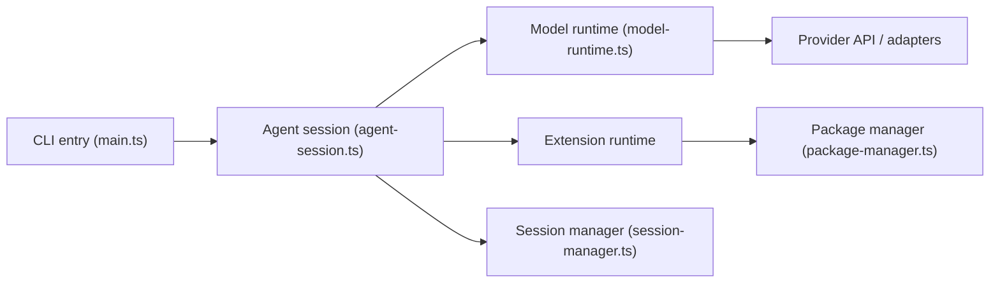

# earendil-works/pi

> Harnais d'agent de code minimaliste et extensible en TypeScript, avec CLI, SDK et paquets partageables.

## Le problème
Les agents de code livrent des fonctions figées (sous-agents, mode plan) ; les adapter à son flux demande de forker.

## Ce que ça fait vraiment
Pi est une CLI interactive (aussi en mode print/JSON, RPC ou SDK) sans sous-agents ni plan mode par défaut : on les ajoute par extensions, skills, templates de prompts et thèmes, partagés comme paquets npm ou git. Le monorepo contient aussi une API LLM multi-fournisseurs, un runtime d'agent, un runtime durable, une bibliothèque TUI et des contrats de télémétrie. Aucun système de permissions intégré.

## Comment c'est branché


## Essayer
```bash
curl -fsSL https://pi.dev/install.sh | sh
npm install -g --ignore-scripts @earendil-works/pi-coding-agent
cd /path/to/project
pi
nix run github:earendil-works/pi/stable
```

## Coût et pièges
Node 22.19+ ; connexion par abonnement ou clé d'API via `/login`. Pas de sandbox : le README conseille Docker, micro-VM Gondolin ou OpenShell. Les nouvelles issues et PR de nouveaux contributeurs sont fermées automatiquement.

## Ce que ce n'est pas
Pas un agent clé en main avec plan mode ou sous-agents. Pas isolé : il tourne avec tes permissions. Le README ne documente ni benchmark ni fonctionnement détaillé.

## Alternatives
- OpenClaw : intégration réelle de Pi citée dans le README.
- pi-chat : automatisation Slack/chat par la même organisation.

## Pour toi
À surveiller : intéressant si tu veux un harnais à façonner ou à embarquer via le SDK, mais conteneurise-le et attends d'avoir un besoin d'extension précis.

