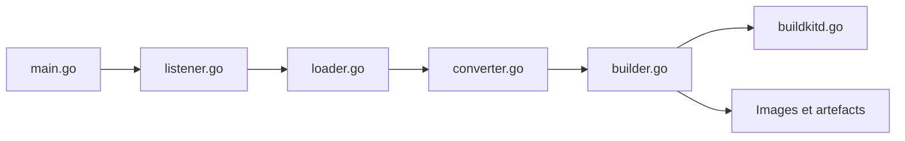

# earthly/earthly

> Containerized build framework, with Earthfiles close to Dockerfile and Makefile, declared unmaintained.

## The problem
Builds that differ between laptop, colleagues and CI, and repeated glue code.

## What it actually does
Reads an `Earthfile` as targets, runs each target in a container via BuildKit, parallelizes and caches. Targets reference each other with `+` (local, other folders, other repos) and can output images and artifacts. `FROM DOCKERFILE` reuses a Dockerfile.

## How it is wired


## Trying it
```bash
earthly +all
earthly github.com/earthly/earthly/examples/go:main+docker
```
The README points to its installation guide.

## Cost and gotchas
Free, requires a BuildKit daemon. 744 open issues.

## What it is not
The README states at the top: "Earthly is no longer actively maintained": not to be adopted in a new project. Not a replacement for Bazel (the README distinguishes them).

## Alternatives
- Bazel: compared in the README, build system for monorepos.
- Plain Dockerfiles: mentioned in the README for single images.

## For you
Ignore: the project declares itself unmaintained, so risky for a durable CI/CD chain.
