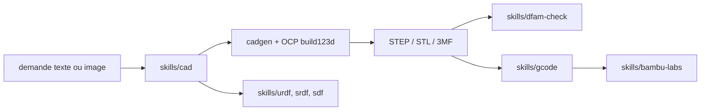

# earthtojake/text-to-cad

> Library of agent skills for CAD, manufacturing and robot files.

## The problem
Asking an agent to produce a mechanical part or a URDF without tooling gives
plausible text and files that a slicer or a simulator cannot use.

## What it actually does
Eleven skills, each with its own `skills/` folder. **CAD** creates and edits models
from a natural-language request or an image, with STEP as the main output and
STL, 3MF, GLB exports. **CAD Viewer** shows a local preview in the browser.
**step.parts** searches for off-the-shelf parts (screws, bearings, motors,
connectors). **DXF** produces 2D drawings. **URDF**, **SRDF**, **SDF** write
robot description files, MoveIt planning groups and simulation worlds. **SendCutSend** checks files
before sending, **DfAM Check** measures printability (wall thickness, overhang, support volume,
orientation), **G-code** slices with real slicer CLIs, **Bambu Labs** cautiously starts a
local print.

## How it is wired


## Trying it
```bash
npx skills add earthtojake/text-to-cad
codex plugin marketplace add earthtojake/text-to-cad
claude plugin marketplace add earthtojake/text-to-cad
claude plugin install cad@text-to-cad
```

## Cost and gotchas
Free. Documented gotcha: `npx skills update` only refreshes skills already
in the lockfile and silently misses new ones — you have to rerun
`npx skills add`. On Windows 11, Smart App Control blocks OCP's unsigned native module:
every `cadgen` command fails, with no per-application exception possible;
you must disable the protection or go through WSL.

## What it is not
Not CAD software nor an online service: skills that drive a local kernel (OCP/OpenCascade). The `models/` fixtures corpus arrives as LFS pointers and
is not needed. No license declared in the README.

## Alternatives
- No alternative repository named in the README.

## For you
Outside the data/AI scope. Ignore, unless you have a personal mechanical project.
