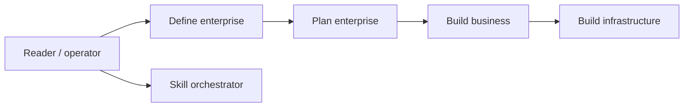

# easychen/opc-methodology

> Book in Chinese on starting a one-person company, with an accompanying set of agent skills.

## The problem
Helping a single person define, plan and build a digital business without a team.

## What it actually does
A book of about 60,000 characters (definition, planning, building, infrastructure) readable online or as an epub (mdbook-epub). Since 2026/04, a set of agent skills: positioning, value proposition, MVP, conversion loop, dashboard review, orchestrator. A company-creation simulator is mentioned.

## How it is wired


## Trying it
```bash
mdbook-epub --standalone true
```

## Cost and gotchas
Free. CC-BY-NC-SA license: non-commercial use, share-alike. The content is in Chinese. The skills' instructions were not read; how they chain together is not established.

## What it is not
Not a software tool: it is a book. The skills are not documented in the README.

## Alternatives
No alternative named in the README.

## For you
Ignore: entrepreneurship methodology, out of scope for data/AI, and in Chinese.
