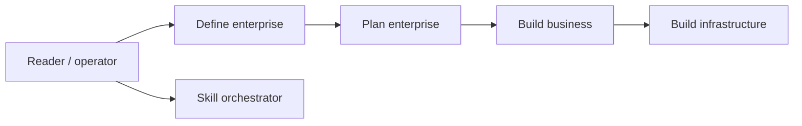

# easychen/opc-methodology

> Livre en chinois sur la création d'entreprise individuelle, avec un jeu de skills d'agents associé.

## Le problème
Aider une personne seule à définir, planifier et bâtir une activité numérique sans équipe.

## Ce que ça fait vraiment
Un livre d'environ 60 000 caractères (définition, planification, construction, infrastructure) lisible en ligne ou en epub (mdbook-epub). Depuis 2026/04, un jeu de skills d'agent : positionnement, proposition de valeur, MVP, boucle de conversion, revue de tableau de bord, orchestrateur. Un simulateur de création d'entreprise est mentionné.

## Comment c'est branché


## Essayer
```bash
mdbook-epub --standalone true
```

## Coût et pièges
Gratuit. Licence CC-BY-NC-SA : usage non commercial, partage dans les mêmes conditions. Le contenu est en chinois. Les instructions des skills n'ont pas été lues ; leur enchaînement n'est pas établi.

## Ce que ce n'est pas
Pas un outil logiciel : c'est un ouvrage. Les skills ne sont pas documentés dans le README.

## Alternatives
Aucune alternative nommée dans le README.

## Pour toi
À ignorer : méthodologie d'entrepreneuriat, hors périmètre data/IA, et en chinois.

