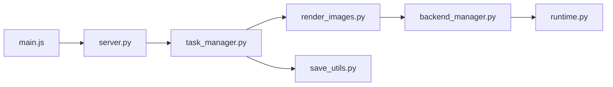

# easydiffusion/easydiffusion

> One-click installer for generating images with Stable Diffusion on your own computer.

## The problem
Installing Stable Diffusion requires technical knowledge and dependencies.

## What it actually does
Provides a local web interface: text-to-image, image-to-image, inpainting, ControlNet, 16 samplers, SDXL, face correction (GFPGAN), upscaling (RealESRGAN), task queue, style modifiers, plugins. The Python server manages tasks and delegates to an inference engine. The README announces recent models (Flux 1 and 2, Z-Image) on the v4 engine.

## How it is wired


## Trying it
```bash
./start.sh
```
On Windows: run `Easy-Diffusion-Windows.exe`.

## Cost and gotchas
8 GB of RAM minimum, 25 GB of disk, NVIDIA or AMD GPU (or CPU, slow). License not identified by GitHub: the license prohibits certain content, read it before use.

## What it is not
Not a hosted service. The advertised performance (5 s at 512×512 on a 3060) is the README's, not verified here.

## Alternatives
No alternative named in the README.

## For you
Worth watching: handy for generating images locally without coding, but read the license before any professional use.
