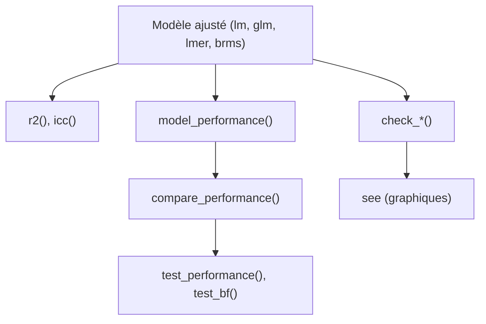

# easystats/performance

> R package for measuring goodness of fit and checking the assumptions of regression models.

## The problem
Model quality indicators (R2, RMSE, ICC, diagnostics) are scattered across packages, with no consistent interface across model types.

## What it actually does
Provides `r2()`, `icc()`, `model_performance()` and `compare_performance()` for lm, glm, mixed and Bayesian models. It tests overdispersion, zero-inflation, singularity and heteroscedasticity, and `check_model()` produces a visual check. `test_performance()` and `test_bf()` compare models. Plots go through the `see` package.

## How it is wired


Simplified diagram based on the fiche, no diagram provided.

## Trying it
```bash
# Dans R :
# install.packages("performance")
# library("performance")
# model <- lm(mpg ~ wt + cyl, data = mtcars)
# r2(model)
```

## Cost and gotchas
Free. An R environment is required; some examples need lme4, brms or rstanarm, the latter being slow to fit.

## What it is not
Not a tool for evaluating machine learning models (no scikit-learn-style classification metrics). It targets statistical regression models.

## Alternatives
No alternative named in the README.

## For you
Worth watching: very useful if you do statistical modeling in R, of little relevance if you mostly work in Python.
