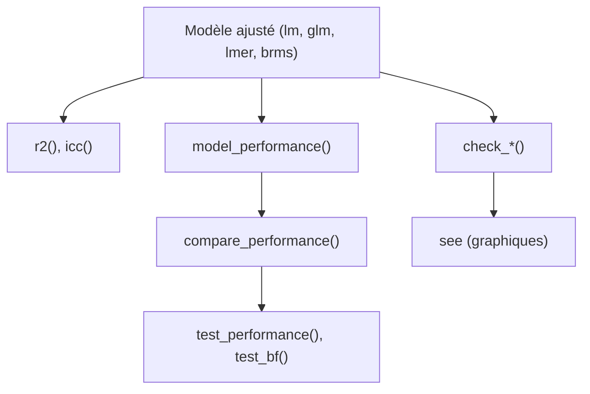

# easystats/performance

> Package R pour mesurer la qualité d'ajustement et vérifier les hypothèses de modèles de régression.

## Le problème
Les indicateurs de qualité de modèle (R2, RMSE, ICC, diagnostics) sont dispersés entre paquets, sans interface cohérente selon le type de modèle.

## Ce que ça fait vraiment
Fournit `r2()`, `icc()`, `model_performance()` et `compare_performance()` pour des modèles lm, glm, mixtes et bayésiens. Il teste surdispersion, zéro-inflation, singularité et hétéroscédasticité, et `check_model()` produit un contrôle visuel. `test_performance()` et `test_bf()` comparent des modèles. Les graphiques passent par le paquet `see`.

## Comment c'est branché


Schéma simplifié d'après la fiche, sans diagramme fourni.

## Essayer
```bash
# Dans R :
# install.packages("performance")
# library("performance")
# model <- lm(mpg ~ wt + cyl, data = mtcars)
# r2(model)
```

## Coût et pièges
Gratuit. Il faut un environnement R ; certains exemples demandent lme4, brms ou rstanarm, ce dernier étant lent à ajuster.

## Ce que ce n'est pas
Pas un outil d'évaluation de modèles de machine learning (pas de métriques de classification type scikit-learn). Il vise les modèles statistiques de régression.

## Alternatives
Aucune alternative nommée dans le README.

## Pour toi
À surveiller : très utile si tu fais de la modélisation statistique en R, peu pertinent si tu travailles surtout en Python.

