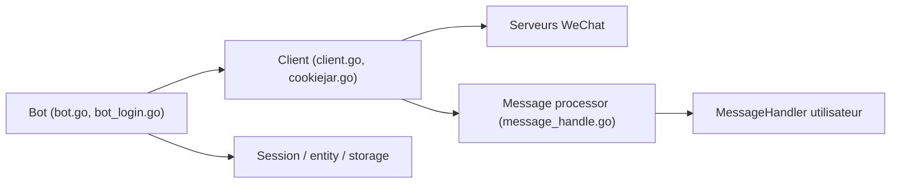

# eatmoreapple/openwechat

> Go library to drive a personal WeChat account and write messaging bots.

## The problem
WeChat offers no simple API for a personal account; bots must go through the web login.

## What it actually does
A Go package: QR code login (with hot login to avoid rescanning), callback message handler, reply and send text, images, files, emoji; friends and groups list; several simultaneous accounts; anti-revocation. README in Chinese.

## How it is wired


## Trying it
```bash
go get -u github.com/eatmoreapple/openwechat
```

## Cost and gotchas
Free. WeChat account required. Last push in January 2025. The README says "bypass login restrictions"; the risks to the account are not documented.

## What it is not
Not an official WeChat API nor a tool for public-type accounts. Its stability depends on WeChat, undocumented.

## Alternatives
No alternative named in the README.

## For you
Ignore: dependence on an unofficial third-party service, single-person project, little activity, unrelated to data or AI.
