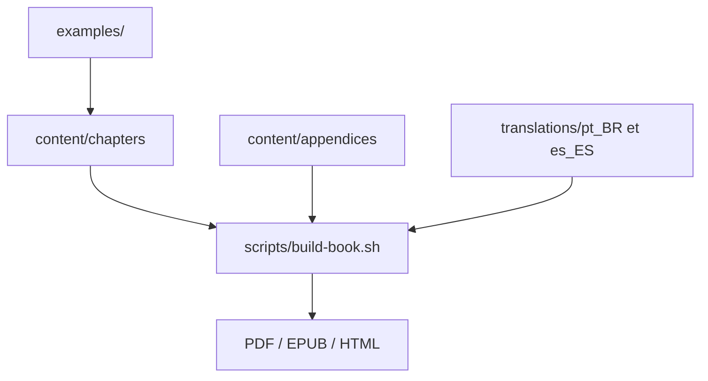

# ebrandi/FDD-book

> Free 38-chapter book for learning to write FreeBSD 14.x device drivers.

## The problem
Resources on FreeBSD kernel drivers assume you already master UNIX, C and the source tree.

## What it actually does
A guided course, 7 parts, 6 appendices, hands-on labs runnable on FreeBSD 14.3 in a VM. A `myfirst` driver grows chapter by chapter up to DMA. PDF, EPUB, HTML and Markdown source versions; the pt_BR and es_ES editions are AI-translated without full technical review.

## How it is wired
Simplified diagram based on the sheet, no diagram provided.


## Trying it
```bash
scripts/build-book.sh
```

## Cost and gotchas
Free, MIT license. About 200 hours of work announced. A FreeBSD 14.x VM is required for the labs. The v2.0 release is presented as a draft.

## What it is not
It is not an official publication of the FreeBSD project, nor a quick reference manual, nor a Linux course.

## Alternatives
No alternative named in the README (it cites man 9 and the Architecture Handbook as references).

## For you
Ignore: FreeBSD kernel drivers do not serve a data / AI / MLOps profile.
