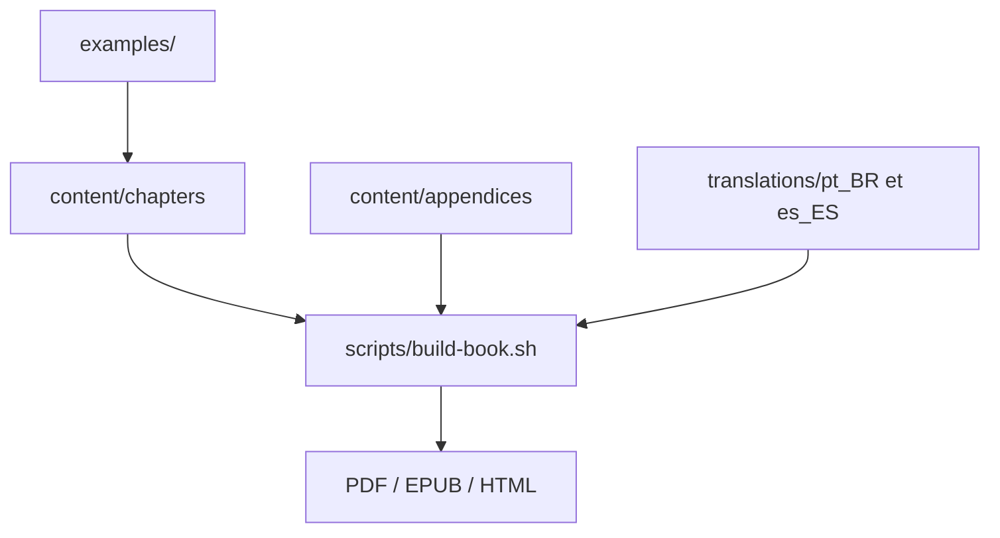

# ebrandi/FDD-book

> Livre libre de 38 chapitres pour apprendre à écrire des pilotes de périphériques FreeBSD 14.x.

## Le problème
Les ressources sur les pilotes noyau FreeBSD supposent que l'on maîtrise déjà UNIX, le C et l'arbre des sources.

## Ce que ça fait vraiment
Cours guidé, 7 parties, 6 annexes, laboratoires exécutables sur FreeBSD 14.3 en VM. Un pilote `myfirst` grossit de chapitre en chapitre jusqu'au DMA. Versions PDF, EPUB, HTML, source Markdown ; les éditions pt_BR et es_ES sont traduites par IA sans relecture technique complète.

## Comment c'est branché
Schéma simplifié d'après la fiche, sans diagramme fourni.


## Essayer
```bash
scripts/build-book.sh
```

## Coût et pièges
Gratuit, licence MIT. Environ 200 h de travail annoncées. Une VM FreeBSD 14.x est nécessaire pour les labos. Release v2.0 présentée comme brouillon.

## Ce que ce n'est pas
Ce n'est pas une publication officielle du projet FreeBSD, ni un manuel de référence rapide, ni un cours Linux.

## Alternatives
Aucune alternative nommée dans le README (il cite man 9 et l'Architecture Handbook comme références).

## Pour toi
À ignorer : les pilotes noyau FreeBSD ne servent pas un profil data / IA / MLOps.

