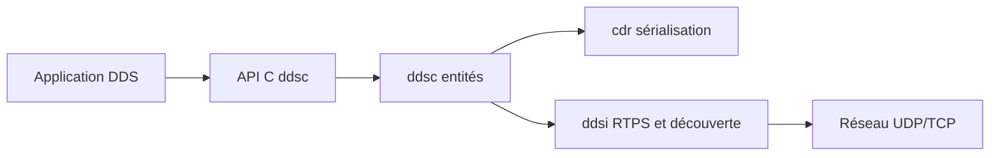

# eclipse-cyclonedds/cyclonedds

> Open source C implementation of the DDS standard, the publish-subscribe middleware at the core of ROS 2.

## The problem
Real-time distributed systems (robotics, autonomous vehicles) need low-latency exchanges, without a central broker, which a classic broker does not guarantee.

## What it actually does
Cyclone DDS implements DCPS, zero-configuration discovery, many quality-of-service settings, DDS Security and XTypes. The core is in C, with C++ and Python bindings in neighboring repositories. An IDL compiler generates the types, and `ddsperf` measures performance.

## How it is wired


## Trying it
```bash
git clone https://github.com/eclipse-cyclonedds/cyclonedds.git
cd cyclonedds
mkdir build
cd build
cmake -DCMAKE_INSTALL_PREFIX=<dossier> ..
cmake --build .
cmake --build . --target install
```

## Cost and gotchas
Free. Requires CMake 3.16 or later and a C compiler. The README admits that the documentation is limited and sometimes obsolete. Zero-configuration discovery assumes multicast.

## What it is not
Not a message broker like Kafka: there is no central server. The license is detected but not identified by GitHub, to be checked before use.

## Alternatives
No alternative named in the README, apart from other DDS implementations, cited without names.

## For you
Worth watching: relevant if you do robotics or embedded work with ROS 2, off-topic for a classic data pipeline.
