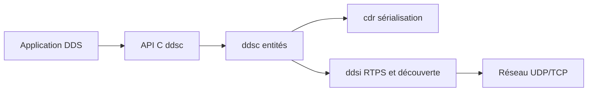

# eclipse-cyclonedds/cyclonedds

> Implémentation open source en C du standard DDS, middleware publication-abonnement central de ROS 2.

## Le problème
Les systèmes distribués temps réel (robotique, véhicules autonomes) ont besoin d'échanges à faible latence, sans courtier central, qu'un broker classique ne garantit pas.

## Ce que ça fait vraiment
Cyclone DDS implémente DCPS, la découverte sans configuration, de nombreux réglages de qualité de service, DDS Security et XTypes. Le cœur est en C, avec liaisons C++ et Python dans des dépôts voisins. Un compilateur IDL génère les types, et `ddsperf` mesure les performances.

## Comment c'est branché


## Essayer
```bash
git clone https://github.com/eclipse-cyclonedds/cyclonedds.git
cd cyclonedds
mkdir build
cd build
cmake -DCMAKE_INSTALL_PREFIX=<dossier> ..
cmake --build .
cmake --build . --target install
```

## Coût et pièges
Gratuit. Il faut CMake 3.16 ou plus et un compilateur C. Le README admet que la documentation est limitée et parfois obsolète. La découverte sans configuration suppose du multicast.

## Ce que ce n'est pas
Pas un courtier de messages type Kafka : il n'y a pas de serveur central. La licence est détectée mais non identifiée par GitHub, à vérifier avant usage.

## Alternatives
Aucune alternative nommée dans le README, hormis d'autres implémentations DDS, citées sans nom.

## Pour toi
À surveiller : pertinent si tu fais de la robotique ou de l'embarqué avec ROS 2, hors sujet pour un pipeline data classique.

