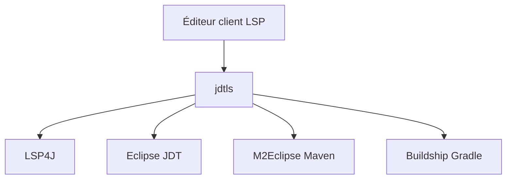

# eclipse-jdtls/eclipse.jdt.ls

> Java language server for any editor that speaks the LSP protocol.

## The problem
Provide Java completion, navigation and refactoring in an editor other than Eclipse.

## What it actually does
Implements the LSP protocol with Eclipse JDT for Java, M2Eclipse for Maven and Buildship for Gradle. Handles Java 1.8 to 25, errors while typing, completion, quick actions, code lenses, call and type hierarchies, formatting. Connects via socket, named pipe or standard streams. Several editors embed it.

## How it is wired
Simplified diagram based on the sheet, no diagram provided.


## Trying it
```bash
JAVA_HOME=/path/to/java/25 ./mvnw clean verify -U
./org.eclipse.jdt.ls.product/target/repository/bin/jdtls -configuration ~/.cache/jdtls -data /path/to/data
```

## Cost and gotchas
Free. Requires at least Java 25 to run and Python 3.9 for the wrapper script. EPL-2.0 license (weak copyleft). 431 open issues.

## What it is not
Not an editor: the repository contains only the server, no client.

## Alternatives
vscode-java for VS Code; nvim-jdtls for Neovim; coc-java for coc.nvim.

## For you
Ignore: useful only if you code in Java; most Java extensions already embed it.
