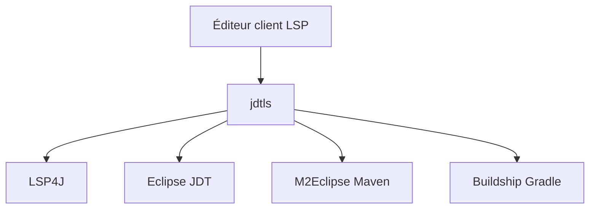

# eclipse-jdtls/eclipse.jdt.ls

> Serveur de langage Java pour tout éditeur qui parle le protocole LSP.

## Le problème
Offrir complétion, navigation et refactorisation Java dans un éditeur autre qu'Eclipse.

## Ce que ça fait vraiment
Implémente le protocole LSP avec Eclipse JDT pour le Java, M2Eclipse pour Maven et Buildship pour Gradle. Gère Java 1.8 à 25, erreurs à la frappe, complétion, actions rapides, lentilles de code, hiérarchies d'appels et de types, formatage. Se connecte par socket, tube nommé ou flux standard. Plusieurs éditeurs l'embarquent.

## Comment c'est branché
Schéma simplifié d'après la fiche, sans diagramme fourni.


## Essayer
```bash
JAVA_HOME=/path/to/java/25 ./mvnw clean verify -U
./org.eclipse.jdt.ls.product/target/repository/bin/jdtls -configuration ~/.cache/jdtls -data /path/to/data
```

## Coût et pièges
Gratuit. Exige un Java 25 au minimum pour tourner et Python 3.9 pour le script d'enveloppe. Licence EPL-2.0 (copyleft faible). 431 issues ouvertes.

## Ce que ce n'est pas
Pas un éditeur : le dépôt ne contient que le serveur, pas de client.

## Alternatives
vscode-java pour VS Code ; nvim-jdtls pour Neovim ; coc-java pour coc.nvim.

## Pour toi
À ignorer : utile seulement si tu codes en Java ; la plupart des extensions Java l'embarquent déjà.

