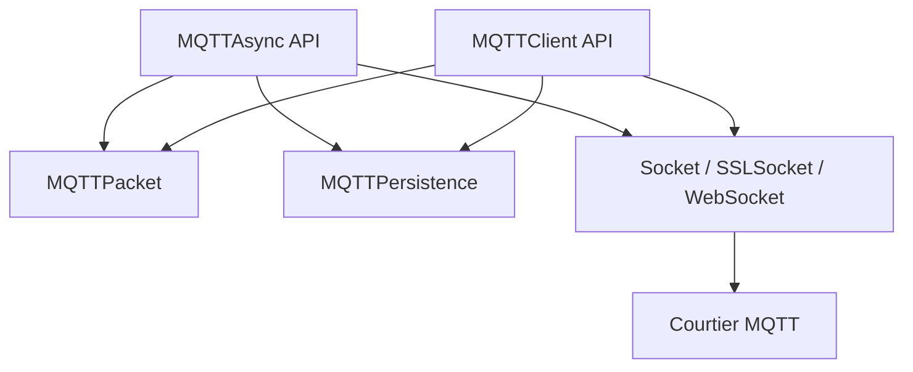

# eclipse-paho/paho.mqtt.c

> MQTT client in C, synchronous and asynchronous, to connect embedded applications to a broker.

## The problem
Publishing and receiving MQTT messages from C or constrained hardware requires a reliable network and protocol stack.

## What it actually does
Four library variants: asynchronous (MQTTAsync) or classic (MQTTClient), with or without SSL/TLS, static or shared. The code handles MQTT 3.1.1 and 5.0, persistence, WebSockets and proxies. Examples and command-line tools (paho_c_pub, paho_c_sub) are provided. Tracing is configured through MQTT_C_CLIENT_TRACE environment variables.

## How it is wired


## Trying it
```bash
mkdir /tmp/build.paho ; cd /tmp/build.paho
cmake -DPAHO_WITH_SSL=TRUE -DPAHO_BUILD_DOCUMENTATION=TRUE \
    -DPAHO_BUILD_SAMPLES=TRUE ~/paho.mqtt.c
cmake --build .
cmake --build . --target install
```

## Cost and gotchas
Free. SSL requires OpenSSL or LibreSSL; tests require a local MQTT broker. The real requirement is CMake and a C compiler. The repository has 239 open issues.

## What it is not
It is not an MQTT broker: you need a server alongside it. It is not a Python or Java binding: those are other Paho repositories.

## Alternatives
No alternative named in the README (a Rust binding is mentioned).

## For you
Adopt if you connect IoT or embedded devices to an MQTT stream: it is the Eclipse foundation's reference C client, mature and portable.
