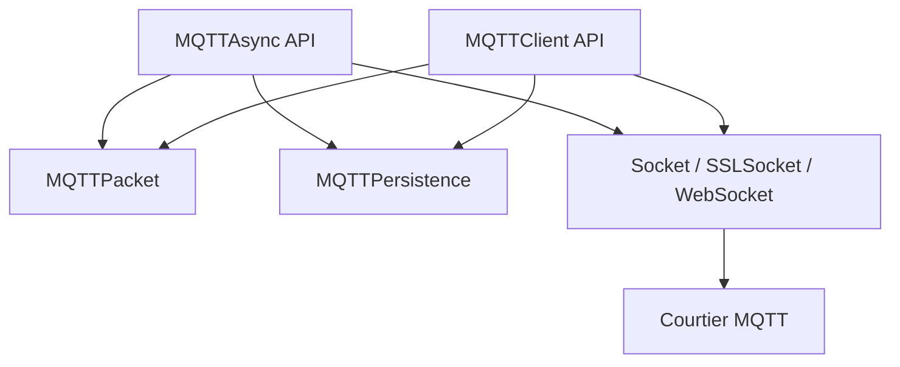

# eclipse-paho/paho.mqtt.c

> Client MQTT en C, synchrone et asynchrone, pour relier des applications embarquées à un courtier.

## Le problème
Publier et recevoir des messages MQTT depuis du C ou du matériel contraint demande une pile réseau et protocole fiable.

## Ce que ça fait vraiment
Quatre variantes de bibliothèque : asynchrone (MQTTAsync) ou classique (MQTTClient), avec ou sans SSL/TLS, en statique ou partagé. Le code gère MQTT 3.1.1 et 5.0, la persistance, les WebSockets et les proxys. Des exemples et des outils en ligne de commande (paho_c_pub, paho_c_sub) sont fournis. Le traçage se règle par variables d'environnement MQTT_C_CLIENT_TRACE.

## Comment c'est branché


## Essayer
```bash
mkdir /tmp/build.paho ; cd /tmp/build.paho
cmake -DPAHO_WITH_SSL=TRUE -DPAHO_BUILD_DOCUMENTATION=TRUE \
    -DPAHO_BUILD_SAMPLES=TRUE ~/paho.mqtt.c
cmake --build .
cmake --build . --target install
```

## Coût et pièges
Gratuit. SSL demande OpenSSL ou LibreSSL ; les tests exigent un courtier MQTT local. Le besoin réel est CMake et un compilateur C. Le dépôt compte 239 issues ouvertes.

## Ce que ce n'est pas
Ce n'est pas un courtier MQTT : il faut un serveur à côté. Ce n'est pas une liaison Python ou Java : ce sont d'autres dépôts Paho.

## Alternatives
Aucune alternative nommée dans le README (une liaison Rust est mentionnée).

## Pour toi
À adopter si tu relies de l'IoT ou de l'embarqué à un flux MQTT : c'est le client C de référence de la fondation Eclipse, mûr et portable.

