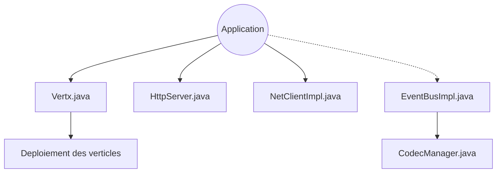

# eclipse-vertx/vert.x

> Asynchronous and networking core for Java applications, for developers of concurrent services.

## The problem
Writing highly concurrent network services in Java with blocking threads is costly in resources and complexity.

## What it actually does
Provides an asynchronous runtime: verticle deployment, execution contexts, Future and Promise, HTTP and WebSocket, TCP, datagrams, DNS, TLS, event bus with codecs, file system, logging adapters. This repository is the core, reused by the other Vert.x components.

## How it is wired


## Trying it
```bash
mvn package
mvn test
mvn package -Pdocs -DskipTests
```

## Cost and gotchas
Free. The README only covers building with Maven: you need a JDK and Maven. License present but not identified by GitHub, to be checked.

## What it is not
Not a full web framework: the README describes it as low-level functionality. Not useful outside the JVM ecosystem.

## Alternatives
- drogonframework/drogon: same asynchronous idea, but in C++.

## For you
Ignore: a data / AI profile has no reason to build reactive Java services, unless there is an existing JVM constraint.
