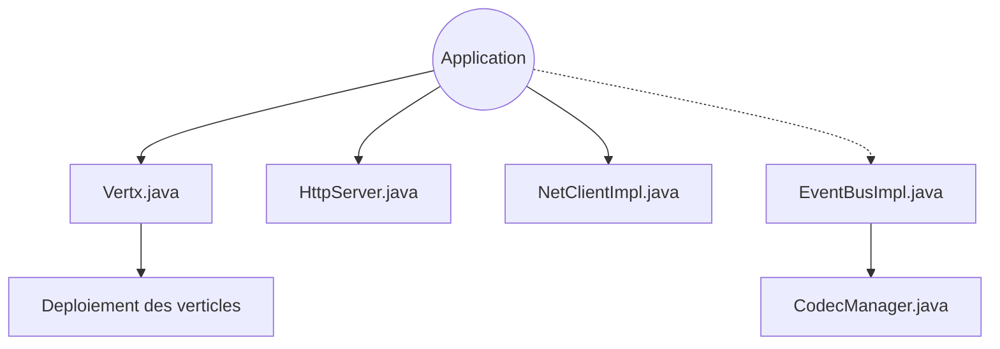

# eclipse-vertx/vert.x

> Noyau asynchrone et réseau pour applications Java, pour les développeurs de services concurrents.

## Le problème
Écrire des services réseau à forte concurrence en Java avec des threads bloquants coûte cher en ressources et en complexité.

## Ce que ça fait vraiment
Fournit un runtime asynchrone : déploiement de verticles, contextes d'exécution, Future et Promise, HTTP et WebSocket, TCP, datagrammes, DNS, TLS, bus d'événements avec codecs, système de fichiers, adaptateurs de journalisation. Ce dépôt est le noyau, repris par les autres composants Vert.x.

## Comment c'est branché


## Essayer
```bash
mvn package
mvn test
mvn package -Pdocs -DskipTests
```

## Coût et pièges
Gratuit. Le README ne couvre que la construction avec Maven : il faut un JDK et Maven. Licence présente mais non identifiée par GitHub, à vérifier.

## Ce que ce n'est pas
Pas un framework web complet : le README le décrit comme de la fonctionnalité de bas niveau. Pas utile hors de l'écosystème JVM.

## Alternatives
- drogonframework/drogon : même idée asynchrone, mais en C++.

## Pour toi
À ignorer : un profil data / IA n'a pas de raison de bâtir des services Java réactifs, sauf contrainte JVM existante.

