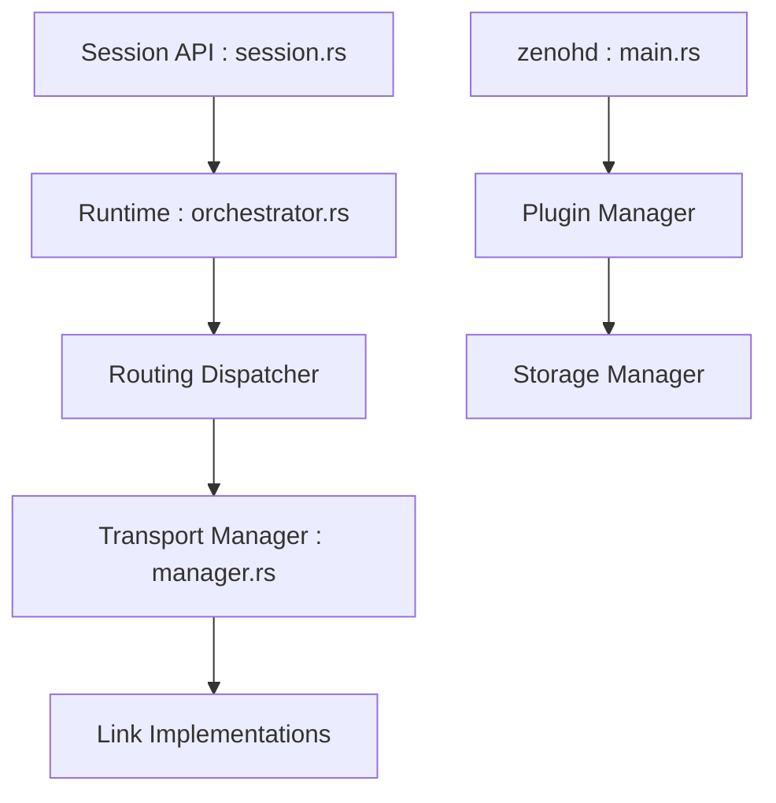

# eclipse-zenoh/zenoh

> Rust protocol and implementation unifying publish-subscribe, queries, storage and compute, from sensor to cloud.

## The problem
Data in motion, data at rest and compute are spread across several stacks (broker, database, RPC) that are hard to unify at the edge.

## What it actually does
The application opens a Session, publishes or subscribes to data by key expression, or issues a query. The routing layer distributes them through the transports (unicast, multicast) to remote peers. The `zenohd` daemon adds plugins, including storage. Shared memory is available.

## How it is wired


## Trying it
```bash
cargo build --release --all-targets
cargo run --example z_sub
cargo run --example z_pub
cargo run -- --config DEFAULT_CONFIG.json5
```

## Cost and gotchas
Stable Rust 1.75+, dependencies sometimes newer. Features such as shared memory must be enabled through a Cargo feature. License not identified by GitHub.

## What it is not
Not a turnkey broker: the `commons` crates are not a stable API. Only `zenoh` and `zenoh-ext` are.

## Alternatives
zenoh-pico, for embedded C; bindings for other languages rely on this Rust implementation.

## For you
Worth watching: relevant for robotics or edge streams in MLOps, but check the license, and useless for a simple batch pipeline.
