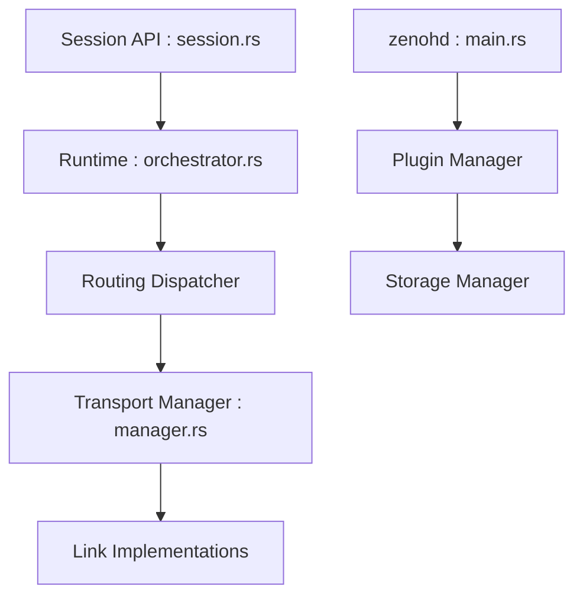

# eclipse-zenoh/zenoh

> Protocole et implémentation Rust unifiant publication-abonnement, requêtes, stockage et calcul, du capteur au cloud.

## Le problème
Données en mouvement, au repos et calcul se répartissent entre plusieurs piles (broker, base, RPC) difficiles à unifier en périphérie.

## Ce que ça fait vraiment
L'application ouvre une Session, publie ou s'abonne à des données par expression de clé, ou lance une requête. La couche de routage les distribue via les transports (unicast, multicast) aux pairs distants. Le démon `zenohd` ajoute des plugins, dont le stockage. Une mémoire partagée est disponible.

## Comment c'est branché


## Essayer
```bash
cargo build --release --all-targets
cargo run --example z_sub
cargo run --example z_pub
cargo run -- --config DEFAULT_CONFIG.json5
```

## Coût et pièges
Rust stable 1.75+, dépendances parfois plus récentes. Fonctions comme la mémoire partagée à activer par feature Cargo. Licence non identifiée par GitHub.

## Ce que ce n'est pas
Pas un broker clé en main : les crates `commons` ne sont pas une API stable. Seuls `zenoh` et `zenoh-ext` le sont.

## Alternatives
zenoh-pico, pour le C embarqué ; les liaisons pour d'autres langages reposent sur cette implémentation Rust.

## Pour toi
À surveiller : pertinent pour des flux robotique ou edge en MLOps, mais à vérifier côté licence et inutile pour un simple pipeline batch.

