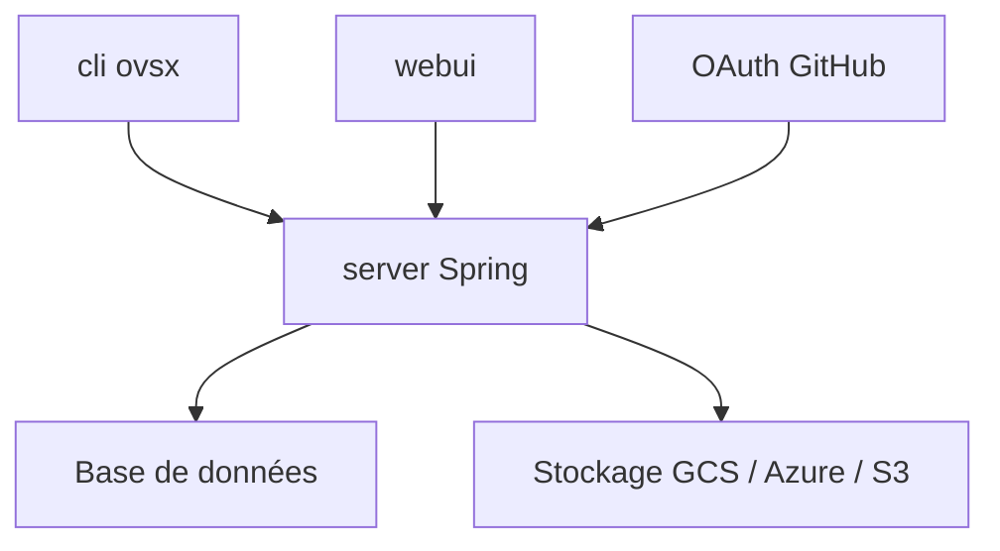

# eclipse/openvsx

> Open VS Code extension registry, a neutral alternative to the Microsoft Marketplace, for whoever hosts it.

## The problem
Editors derived from VS Code cannot legally use the Microsoft Marketplace, and a company may want its own registry.

## What it actually does
Spring server that stores extensions in a database, a Marketplace-style web application and an ovsx CLI to publish. File storage possible on Google Cloud, Azure Blob or S3. Public instance at open-vsx.org, mirror mode and administration roles documented in the wiki.

## How it is wired
Simplified diagram based on the sheet, no diagram provided.


## Trying it
```bash
./gradlew build
./gradlew runServer
yarn build
```

## Cost and gotchas
Cloud storage, OAuth and the database require accounts and environment variables. Docker images changed address starting with v0.33.0 (ghcr.io/eclipse-openvsx).

## What it is not
Not a simple plugin: it is a full service to operate. It does not contain the extensions themselves.

## Alternatives
- Visual Studio Marketplace: the Microsoft service it replaces.

## For you
Watch: useful if your AI platform offers an internal web IDE to plug into a private registry.
