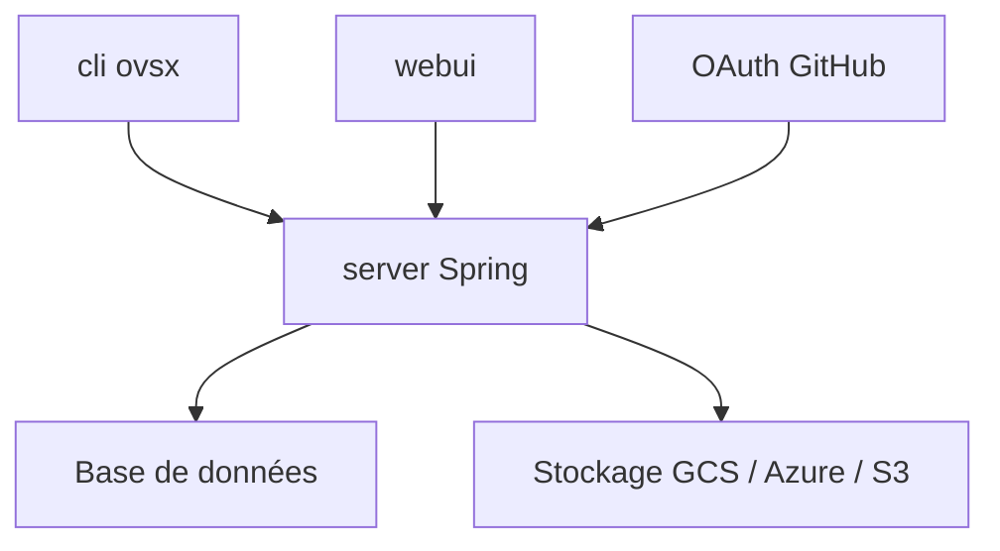

# eclipse/openvsx

> Registre d'extensions VS Code ouvert, alternative neutre au Marketplace Microsoft, pour qui l'héberge.

## Le problème
Les éditeurs dérivés de VS Code ne peuvent pas utiliser légalement le Marketplace Microsoft, et une entreprise peut vouloir son propre registre.

## Ce que ça fait vraiment
Serveur Spring qui stocke les extensions en base, application web façon Marketplace et CLI ovsx pour publier. Stockage de fichiers possible sur Google Cloud, Azure Blob ou S3. Instance publique sur open-vsx.org, mode miroir et rôles d'administration documentés dans le wiki.

## Comment c'est branché
Schéma simplifié d'après la fiche, sans diagramme fourni.


## Essayer
```bash
./gradlew build
./gradlew runServer
yarn build
```

## Coût et pièges
Le stockage cloud, OAuth et la base demandent comptes et variables d'environnement. Les images Docker ont changé d'adresse à partir de v0.33.0 (ghcr.io/eclipse-openvsx).

## Ce que ce n'est pas
Pas un simple plugin : c'est un service complet à exploiter. Il ne contient pas les extensions elles-mêmes.

## Alternatives
- Visual Studio Marketplace : le service Microsoft auquel il se substitue.

## Pour toi
Surveiller : utile si ta plateforme IA propose un IDE web interne à brancher sur un registre privé.

