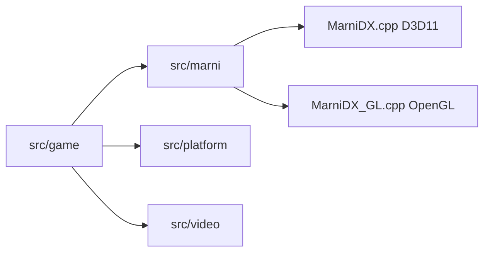

# ecruells/resident-evil-pc-decomp

> Port of Resident Evil 1 (PC, 1997) rebuilt from a Ghidra decompilation, for Windows and Linux.

## The problem
The 1997 game no longer runs properly on modern systems and its source code is not public.

## What it actually does
Rewrites the game logic from the decompiled binary and runs it on Direct3D 11 (Windows) or OpenGL 3.3 with SDL2 (Linux). The README claims a fully playable game: 1716 of 1717 functions implemented. It adds an HD mode in WebP, an options menu and Director's Cut mode.

## How it is wired


## Trying it
```bash
cmake -S . -B build/linux -DCMAKE_BUILD_TYPE=Release
cmake --build build/linux -j
./build/linux/residentevil
```

## Cost and gotchas
You need your own legal copy of the game (no assets provided). Linux: 32-bit binary, 32-bit ffmpeg and SDL2; Windows: Visual Studio and MSBuild. The Battle Game of Saturn mode is not finished.

## What it is not
Not a ready-to-launch game, nor a project affiliated with Capcom. Ownership of the code remains with Capcom.

## Alternatives
Classic REbirth and the Seamless HD Project are cited as sources of HD packs.

## For you
Ignore: a video game preservation project, unrelated to data / AI / MLOps.
