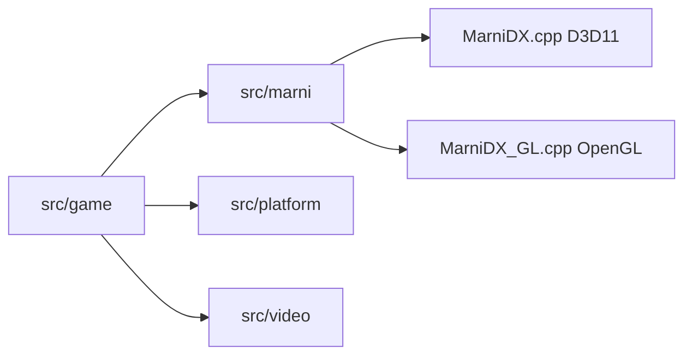

# ecruells/resident-evil-pc-decomp

> Port de Resident Evil 1 (PC, 1997) reconstruit depuis une décompilation Ghidra, pour Windows et Linux.

## Le problème
Le jeu de 1997 ne tourne plus correctement sur les systèmes modernes et son code source n'est pas public.

## Ce que ça fait vraiment
Réécrit la logique du jeu à partir du binaire décompilé et la fait tourner sur Direct3D 11 (Windows) ou OpenGL 3.3 avec SDL2 (Linux). Le README annonce un jeu entièrement jouable : 1716 fonctions sur 1717 implémentées. Il ajoute un mode HD en WebP, un menu d'options et le mode Director's Cut.

## Comment c'est branché


## Essayer
```bash
cmake -S . -B build/linux -DCMAKE_BUILD_TYPE=Release
cmake --build build/linux -j
./build/linux/residentevil
```

## Coût et pièges
Il faut ta propre copie légale du jeu (aucun asset fourni). Linux : binaire 32 bits, ffmpeg et SDL2 en 32 bits ; Windows : Visual Studio et MSBuild. Le mode Battle Game du mode Saturn n'est pas terminé.

## Ce que ce n'est pas
Pas un jeu prêt à lancer, ni un projet affilié à Capcom. La propriété du code reste à Capcom.

## Alternatives
Classic REbirth et le Seamless HD Project sont cités comme source de packs HD.

## Pour toi
À ignorer : projet de préservation de jeu vidéo, sans lien avec data / IA / MLOps.

