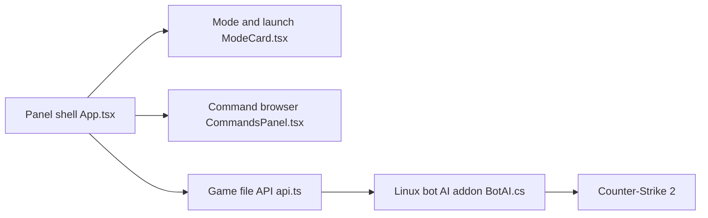

# ed0ard/CS2-Bot-Improver

> Plugin for Counter-Strike 2 that improves bot aim, grenades and strategy in offline matches.

## The problem
CS2 bots aim poorly, get stuck and play without strategy.

## What it actually does
Package to copy into `game/csgo`: more human-like aim, grenade throwing, movement, buy economy, pro player names and profiles based on HLTV, skin customization. Windows panel (Tauri) to choose the mode and launch the game. CounterStrikeSharp plugins on the game side.

## How it is wired


## Trying it
```bash
bot_aim head
bot_nades more
br_reroll
```
These commands are typed into the game console after installing the package.

## Cost and gotchas
Free. Manual installation into the game folder; the panel exists only on Windows. To play online, revert `gameinfo.gi` and remove `-insecure`.

## What it is not
Not a plugin for ranked online play: intended for offline matches and private games.

## Alternatives
No alternative named in the README (bot projects are credited).

## For you
Ignore: game modification unrelated to data or AI.
