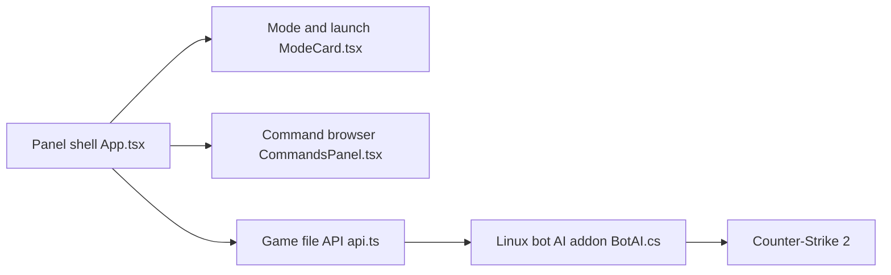

# ed0ard/CS2-Bot-Improver

> Greffon pour Counter-Strike 2 qui améliore visée, grenades et stratégie des bots en parties hors ligne.

## Le problème
Les bots de CS2 visent mal, se bloquent et jouent sans stratégie.

## Ce que ça fait vraiment
Paquet à copier dans `game/csgo` : visée plus humaine, lancer de grenades, déplacements, économie d'achats, noms de pros et profils selon HLTV, personnalisation des skins. Panneau Windows (Tauri) pour choisir le mode et lancer le jeu. Greffons CounterStrikeSharp côté jeu.

## Comment c'est branché


## Essayer
```bash
bot_aim head
bot_nades more
br_reroll
```
Ces commandes se saisissent dans la console du jeu après installation du paquet.

## Coût et pièges
Gratuit. Installation manuelle dans le dossier du jeu ; le panneau n'existe que sous Windows. Pour jouer en ligne, retour à `gameinfo.gi` et retrait de `-insecure`.

## Ce que ce n'est pas
Pas un greffon pour le jeu en ligne classé : prévu pour matchs hors ligne et parties privées.

## Alternatives
Aucune alternative nommée dans le README (des projets de bots sont crédités).

## Pour toi
À ignorer : modification de jeu sans rapport avec la data ou l'IA.

