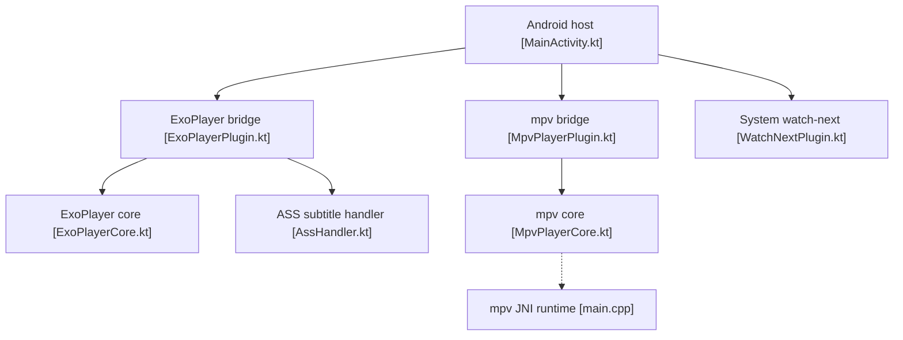

# edde746/plezy

> Single Flutter client to play media from Plex, Jellyfin and Emby servers, on desktop, mobile and TV.

## The problem
Official clients are separate per server and per platform. Anyone mixing Plex, Jellyfin and Emby juggles several apps.

## What it actually does
Browses and plays video and music from several servers at once, with cross-search. Handles offline downloads, Live TV/DVR, Trakt/AniList sync, remote shared playback (Watch Together). Playback relies on mpv, ExoPlayer on Android. Interface in 22 languages.

## How it is wired

The diagram only covers the Android side; the Flutter code was not sampled.

## Trying it
```bash
brew tap edde746/plezy https://github.com/edde746/plezy
brew install --cask plezy
winget install edde746.Plezy
sudo pacman -S plezy
```

## Cost and gotchas
You need a Plex account, or a Jellyfin/Emby server with credentials. The Flatpak requires a Wayland session for video and is not on Flathub.

## What it is not
Not a media server: you must already have one. Several features depend on the platform (PiP, HDR, downloads missing on tvOS). 327 open issues.

## Alternatives
No alternative named in the README (it only cites mpv-build/MPVKit as a playback base).

## For you
Watch: useful if you have a media home lab, but off-topic for data/AI/MLOps, and GPL-3.0 license with a single maintainer.
