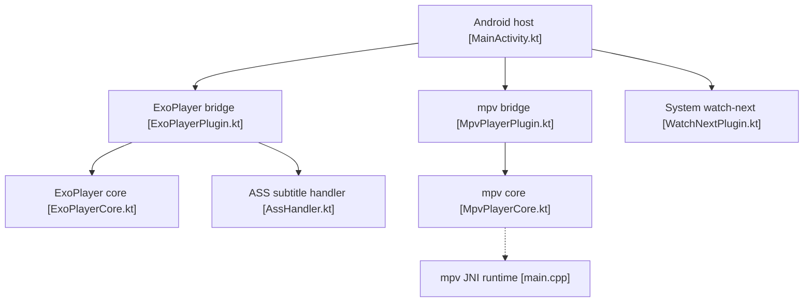

# edde746/plezy

> Client Flutter unique pour lire les médias de serveurs Plex, Jellyfin et Emby, sur bureau, mobile et TV.

## Le problème
Les clients officiels sont séparés par serveur et par plateforme. Qui mélange Plex, Jellyfin et Emby jongle entre plusieurs applications.

## Ce que ça fait vraiment
Parcourt et lit vidéo et musique de plusieurs serveurs à la fois, avec recherche croisée. Gère téléchargements hors-ligne, Live TV/DVR, synchro Trakt/AniList, lecture partagée à distance (Watch Together). La lecture s'appuie sur mpv, ExoPlayer sur Android. Interface en 22 langues.

## Comment c'est branché

Le diagramme ne couvre que le côté Android ; le code Flutter n'a pas été échantillonné.

## Essayer
```bash
brew tap edde746/plezy https://github.com/edde746/plezy
brew install --cask plezy
winget install edde746.Plezy
sudo pacman -S plezy
```

## Coût et pièges
Il faut un compte Plex, ou un serveur Jellyfin/Emby avec identifiants. Le Flatpak exige une session Wayland pour la vidéo et n'est pas sur Flathub.

## Ce que ce n'est pas
Ce n'est pas un serveur de médias : il faut déjà en avoir un. Plusieurs fonctions dépendent de la plateforme (PiP, HDR, téléchargements absents sur tvOS). 327 issues ouvertes.

## Alternatives
Aucune alternative nommée dans le README (il cite seulement mpv-build/MPVKit comme base de lecture).

## Pour toi
Surveiller : utile si tu as un home-lab média, mais hors sujet data/IA/MLOps, et licence GPL-3.0 avec un seul mainteneur.

