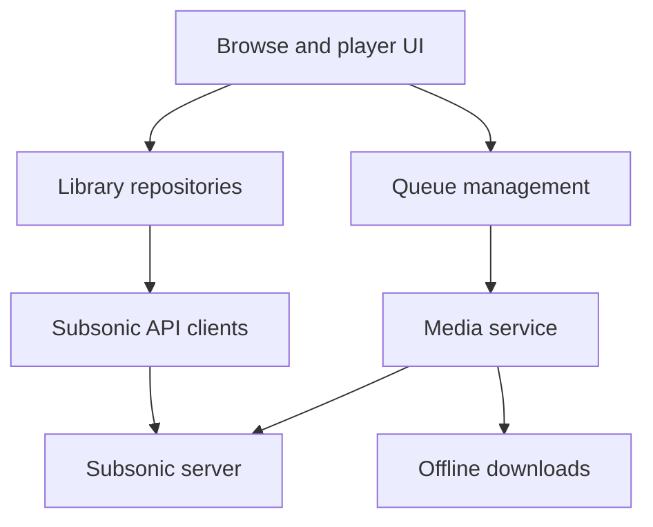

# eddyizm/tempus

> Android client for Subsonic music servers, focused on your library and your history.

## The problem
You need an Android player that talks to your own Subsonic server without an opaque recommendation algorithm.

## What it actually does
Browse and search the library, streaming or offline playback, playlists, gapless playback, ReplayGain, equalizer, podcasts, radio stations, Last.fm and ListenBrainz scrobbling, server-side transcoding. The GitHub version adds Chromecast and Android Auto.

## How it is wired

## Trying it
No commands: the README points to APKs. Take `app-tempus` (GitHub, with Android Auto and Chromecast) or `app-degoogled*` (IzzyOnDroid) from the releases, or F-Droid.

## Cost and gotchas
Free, but you already need a Subsonic server. Offline mode is flagged as under development with limits in multi-server setups. Chromecast is rudimentary.

## What it is not
Not a music server. Fork of Tempo (v3.9.0). Several features depend on your server's capabilities.

## Alternatives
- Tempo (CappielloAntonio): the original project of which Tempus is a fork.

## For you
Ignore: personal music player, unrelated to data / AI / MLOps work.
