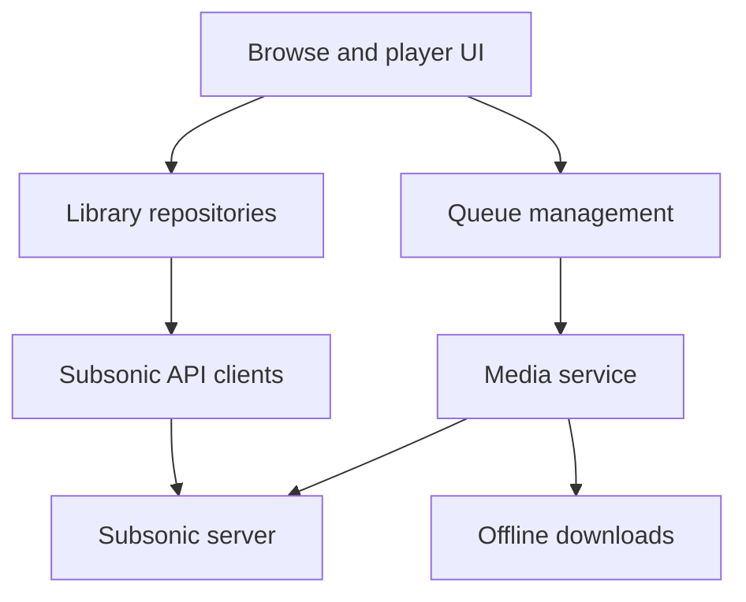

# eddyizm/tempus

> Client Android pour serveurs de musique Subsonic, axé sur ta bibliothèque et ton historique.

## Le problème
Il faut un lecteur Android qui parle à ton propre serveur Subsonic sans algorithme de recommandation opaque.

## Ce que ça fait vraiment
Parcourir et chercher la bibliothèque, lecture en continu ou hors ligne, listes de lecture, lecture sans blanc, ReplayGain, égaliseur, podcasts, radios, scrobbling Last.fm et ListenBrainz, transcodage côté serveur. La version GitHub ajoute Chromecast et Android Auto.

## Comment c'est branché

## Essayer
Aucune commande : le README renvoie à des APK. Prendre `app-tempus` (GitHub, avec Android Auto et Chromecast) ou `app-degoogled*` (IzzyOnDroid) depuis les releases, ou F-Droid.

## Coût et pièges
Gratuit, mais il faut déjà un serveur Subsonic. Le mode hors ligne est signalé en développement avec limites en multi-serveurs. Chromecast est rudimentaire.

## Ce que ce n'est pas
Pas un serveur de musique. Fork de Tempo (v3.9.0). Plusieurs fonctions dépendent des capacités de ton serveur.

## Alternatives
- Tempo (CappielloAntonio) : projet d'origine dont Tempus est le fork.

## Pour toi
À ignorer : lecteur musical personnel, sans lien avec un travail data / IA / MLOps.

