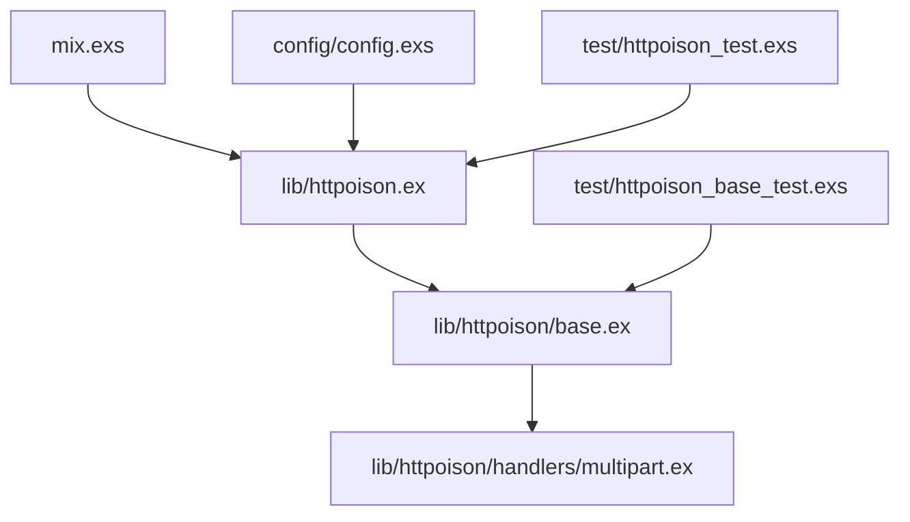

# edgurgel/httpoison

> HTTP client for Elixir, built on hackney, aimed at Elixir service developers.

## The problem
Calling HTTP APIs from Elixir without hand-writing the handling of connections, headers, cookies and multipart.

## What it actually does
Provides get/post/request with Response and Error structures, SSL options and timeouts, asynchronous requests via messages, hackney connection pools, multipart for sending and receiving. The Base module lets you build an API client with process_* hooks (URL, body, headers). Version 3.x depends on hackney 4.0.

## How it is wired


## Trying it
```bash
mix deps.get
```
```elixir
{:httpoison, "~> 3.0"}
HTTPoison.start
HTTPoison.get! "https://postman-echo.com/get"
```

## Cost and gotchas
Free. Requires Erlang/OTP 27 or later (so Elixir 1.17+) for 3.x; since 2.x the ssl option merges with the defaults instead of replacing them. Async mode can flood the receiver with messages without `async: :once`.

## What it is not
Not a standalone tool: only an Elixir dependency. Not an HTTP client for Python or for a data pipeline.

## Alternatives
No alternative named in the README (HTTPotion is cited as the original basis).

## For you
Ignore for a data/AI/MLOps profile: it is an Elixir building block, useful only if your stack is Elixir.
