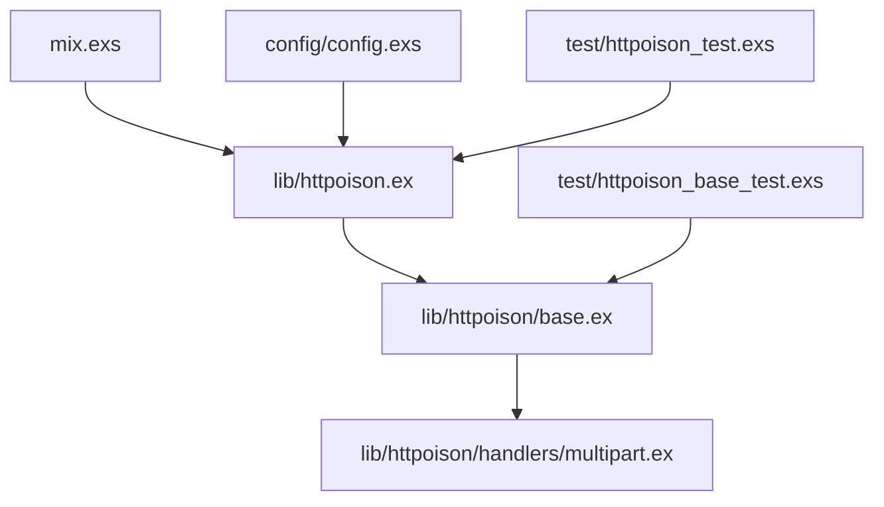

# edgurgel/httpoison

> Client HTTP pour Elixir, construit sur hackney, destiné aux développeurs de services Elixir.

## Le problème
Appeler des API HTTP depuis Elixir sans écrire à la main la gestion des connexions, des en-têtes, des cookies et du multipart.

## Ce que ça fait vraiment
Fournit get/post/request avec structures Response et Error, options SSL et timeouts, requêtes asynchrones par messages, pools de connexions hackney, multipart en envoi et en réception. Le module Base permet de bâtir un client d'API par hooks process_* (URL, corps, en-têtes). La version 3.x dépend de hackney 4.0.

## Comment c'est branché


## Essayer
```bash
mix deps.get
```
```elixir
{:httpoison, "~> 3.0"}
HTTPoison.start
HTTPoison.get! "https://postman-echo.com/get"
```

## Coût et pièges
Gratuit. Exige Erlang/OTP 27 ou plus (donc Elixir 1.17+) pour la 3.x ; depuis la 2.x l'option ssl fusionne avec les défauts au lieu de les remplacer. Le mode asynchrone peut inonder le récepteur de messages sans `async: :once`.

## Ce que ce n'est pas
Pas un outil autonome : une dépendance Elixir uniquement. Pas de client HTTP pour Python ni pour un pipeline de données.

## Alternatives
Aucune alternative nommée dans le README (HTTPotion est cité comme base d'origine).

## Pour toi
À ignorer pour un profil data/IA/MLOps : c'est une brique Elixir, utile seulement si ta pile est en Elixir.

