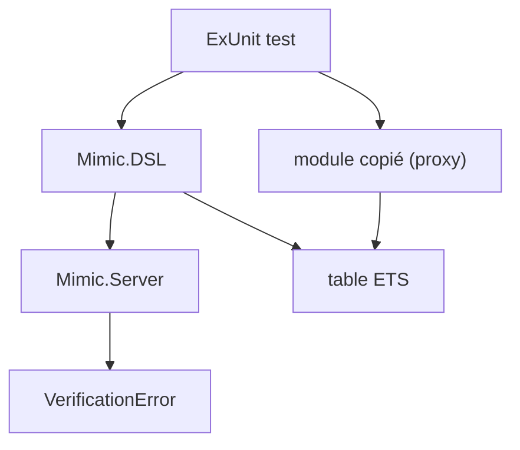

# edgurgel/mimic

> Mocking library for Elixir tests, inspired by Meck and Mox.

## The problem
Replacing the behavior of Elixir modules in tests calls for dependency-injection mocks, which are heavy to write.

## What it actually does
`Mimic.copy(Module)` prepares a module; `stub`, `expect`, `reject`, `stub_with`, `call_original` and `calls` then modify its behavior. Each call goes through an ETS table that decides what each process sees (private mode by default, global mode possible). A DSL mode and an experimental type check (Ham) exist.

## How it is wired


## Trying it
```elixir
{:mimic, "~> 2.0", only: :test}
Mimic.copy(Calculator)
ExUnit.start()
```

## Cost and gotchas
Free. Elixir required. Unqualified intra-module calls are not intercepted; global mode forbids concurrent tests. Slight call overhead measured by the README.

## What it is not
It is not a tool for other languages: it targets Elixir and ExUnit.

## Alternatives
- Meck: cited in the README as an inspiration.
- Mox: cited in the README as an inspiration.

## For you
Ignore: reserved for Elixir teams, unrelated to data / AI / MLOps work.
