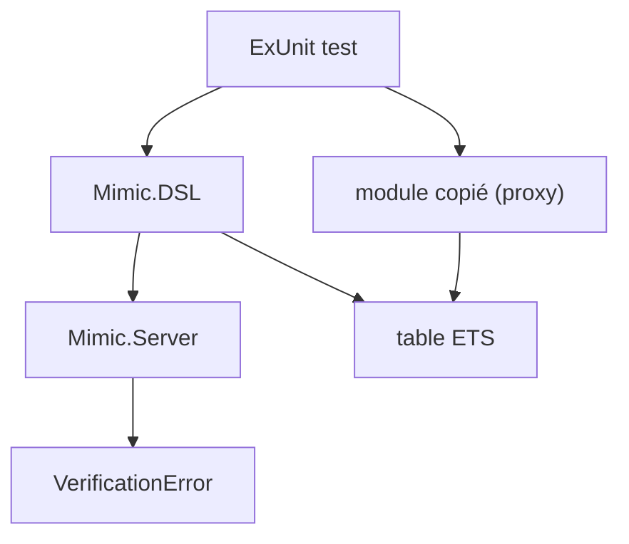

# edgurgel/mimic

> Bibliothèque de mocks pour tests Elixir, inspirée de Meck et Mox.

## Le problème
Remplacer le comportement de modules Elixir dans les tests demande des mocks par injection de dépendances, lourds à écrire.

## Ce que ça fait vraiment
`Mimic.copy(Module)` prépare un module ; `stub`, `expect`, `reject`, `stub_with`, `call_original` et `calls` modifient ensuite son comportement. Chaque appel passe par une table ETS qui décide ce que voit chaque processus (mode privé par défaut, mode global possible). Un mode DSL et un contrôle de types expérimental (Ham) existent.

## Comment c'est branché


## Essayer
```elixir
{:mimic, "~> 2.0", only: :test}
Mimic.copy(Calculator)
ExUnit.start()
```

## Coût et pièges
Gratuit. Elixir requis. Les appels intra-module non qualifiés ne sont pas interceptés ; le mode global interdit les tests concurrents. Léger surcoût d'appel mesuré par le README.

## Ce que ce n'est pas
Ce n'est pas un outil pour d'autres langages : il vise Elixir et ExUnit.

## Alternatives
- Meck : cité dans le README comme inspiration.
- Mox : cité dans le README comme inspiration.

## Pour toi
À ignorer : réservé aux équipes Elixir, sans rapport avec un travail data / IA / MLOps.

