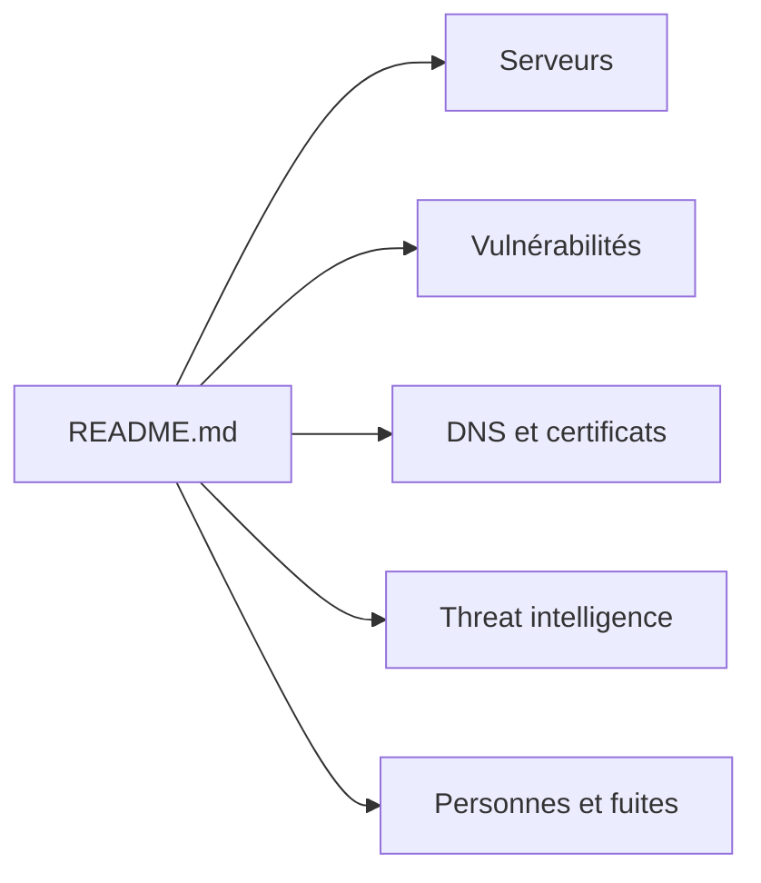

# edoardottt/awesome-hacker-search-engines

> A list of search engines for security and OSINT, sorted by theme, for analysts.

## The problem
The sources useful for a security audit or watch are scattered: exposed servers, CVEs, DNS, certificates, leaks, malware.

## What it actually does
A single README, with no code, pointing to hundreds of external services, organized by category: general engines, servers (Shodan, Censys), vulnerabilities, exploits, attack surface, DNS, certificates, threat intelligence, web archives. Some categories touch personal data (people, phones, leaks, cameras): their use is subject to applicable law (GDPR, etc.). A section flags services that are down.

## How it is wired

## Trying it
Nothing to install: you read the README. Change proposals go through an issue or a pull request.

## Cost and gotchas
Free for the list; many listed services require an account or an API key, or are paid.

## What it is not
Not an executable tool. The services are not verified by the repository (a section already lists the dead ones). The categories on people and leaks require a clear legal framework.

## Alternatives
None named in the README.

## For you
To watch: a good bookmark for CVE watch or exposure inventory, with no direct value for a data/AI pipeline.
