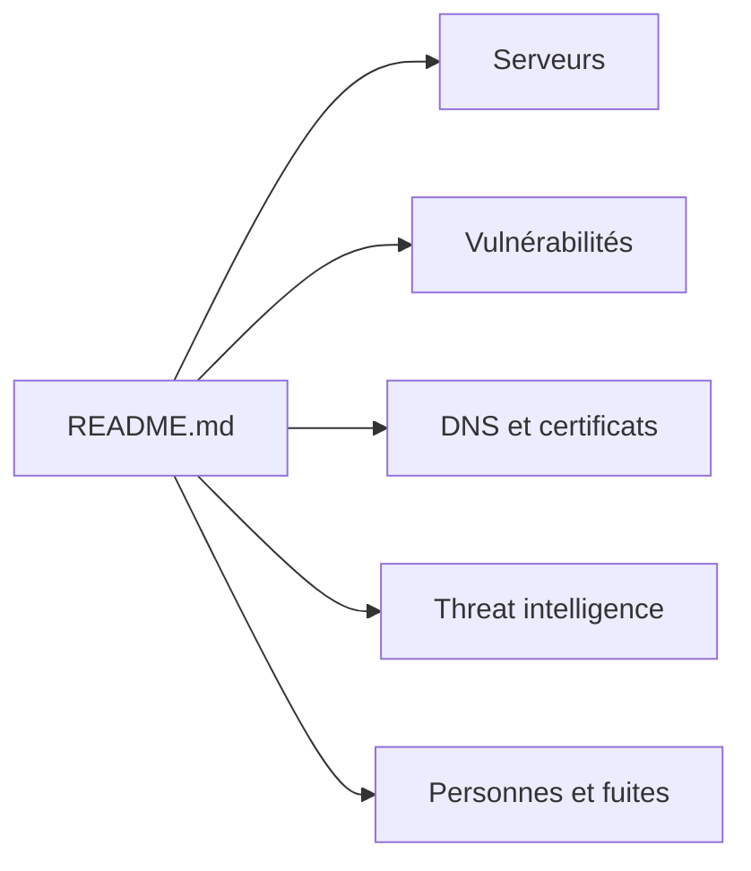

# edoardottt/awesome-hacker-search-engines

> Liste de moteurs de recherche pour la sécurité et l'OSINT, classés par thème, pour analystes.

## Le problème
Les sources utiles à un audit ou une veille sécurité sont dispersées : serveurs exposés, CVE, DNS, certificats, fuites, malwares.

## Ce que ça fait vraiment
Un README unique, sans code, qui renvoie vers des centaines de services externes, rangés par catégories : moteurs généralistes, serveurs (Shodan, Censys), vulnérabilités, exploits, surface d'attaque, DNS, certificats, threat intelligence, archives web. Certaines catégories touchent des données personnelles (personnes, téléphones, fuites, caméras) : leur usage est soumis au droit applicable (RGPD, etc.). Une section signale les services hors service.

## Comment c'est branché

## Essayer
Rien à installer : on lit le README. Les propositions de changement passent par une issue ou une pull request.

## Coût et pièges
Gratuit pour la liste ; beaucoup de services listés demandent un compte ou une clé d'API, ou sont payants.

## Ce que ce n'est pas
Pas un outil exécutable. Les services ne sont pas vérifiés par le dépôt (une section recense déjà les morts). Les catégories sur les personnes et les fuites exigent un cadre légal clair.

## Alternatives
Aucune nommée dans le README.

## Pour toi
À surveiller : bon signet pour de la veille CVE ou de l'inventaire d'exposition, sans valeur directe pour un pipeline data/IA.

