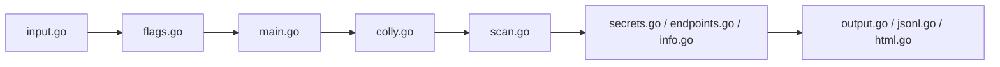

# edoardottt/cariddi

> Command-line URL crawler that spots endpoints, secrets and sensitive files, for authorized testing.

## The problem
During an audit, manually spotting exposed endpoints, API keys and tokens across many pages is time-consuming.

## What it actually does
- Reads targets from standard input and crawls pages with the Colly crawler (`colly.go`).
- Analyzes responses (`scan.go`) to detect secrets, endpoints, file extensions, errors and useful information.
- Options: concurrency, delay, HTTP/SOCKS5 proxy, custom headers, random user-agent, maximum depth, cache.
- Outputs: console, TXT, HTML, JSON, archive of HTTP responses; integration with the Burp proxy is possible.

## How it is wired


## Trying it
```bash
brew install cariddi
go install -v github.com/edoardottt/cariddi/cmd/cariddi@latest
echo https://edoardottt.com/ | cariddi
cat urls.txt | cariddi -s -e -json
echo "https://edoardottt.github.io/cariddi-test/" | cariddi
```

## Cost and gotchas
Free, Go binary (Go 1.24+ to compile). The default concurrency level is 20: tune `-c` and `-d` so as not to overload the target.

## What it is not
It is not a full vulnerability scanner: it spots clues in responses. Use it only on targets you own or for which you have authorization; the README does not include an explicit legal warning. GPL-3.0 license.

## Alternatives
No alternative named in the README (it thanks go-colly and projectdiscovery).

## For you
Worth watching: useful for auditing your own applications (secret leaks in exposed pages), with no direct link to data/MLOps work outside security auditing.
