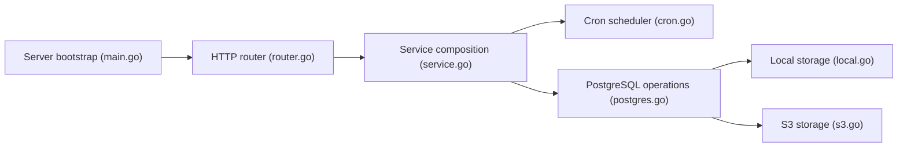

# eduardolat/pgbackweb

> Web interface to schedule, monitor and restore PostgreSQL backups, for developers and small teams.

## The problem
`pg_dump` backups run from cron lack monitoring, notifications and one-click restore.

## What it actually does
Go application with its own PostgreSQL database: you declare databases and destinations (local or several S3 buckets), schedule backups, view execution logs, download or restore, and receive webhooks. Compatible with PostgreSQL 13 to 18, with PGP encryption and health checks. The project is becoming "UFO Backup".

## How it is wired


## Trying it
```bash
# docker compose avec l'image eduardolat/pgbackweb:latest, variables :
# PBW_ENCRYPTION_KEY et PBW_POSTGRES_CONN_STRING
docker exec -it <container_name_or_id> sh -c change-password
```

## Cost and gotchas
Free. Keep `PBW_ENCRYPTION_KEY` in a safe place: it encrypts sensitive data. A dedicated PostgreSQL database is required. AGPL-3.0 license.

## What it is not
Not multi-engine for now (PostgreSQL only). Not a disaster recovery guarantee: testing restores remains your responsibility.

## Alternatives
No alternative named in the README.

## For you
Adopt to back up the PostgreSQL databases of ML platforms without writing scripts; remember to test a restore.
