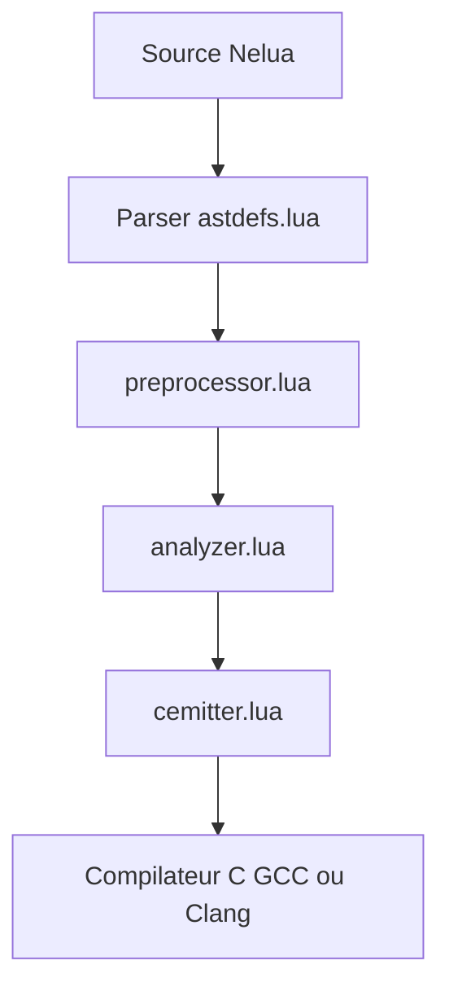

# edubart/nelua-lang

> System programming language close to Lua, compiling to C, for performance and metaprogramming.

## The problem
Lua is too slow for a system or a game, and C is cumbersome to write: the author wants both in a single syntax.

## What it actually does
The compiler, written in Lua, parses the code, runs the Lua preprocessor, checks types, generates readable C, then calls a C compiler to produce the binary. The garbage collector is optional; memory can be managed manually. The README states that the language is in alpha.

## How it is wired


## Trying it
```bash
nelua examples/snakesdl.nelua
```

## Cost and gotchas
Free. A C compiler (GCC or Clang) is required; installation is not detailed in this README. Last push in June 2025, a single maintainer, alpha.

## What it is not
Not a faster Lua: a distinct, typed language that produces C.

## Alternatives
No alternative named in the README.

## For you
Ignore: niche alpha language with no numerical or AI ecosystem.
