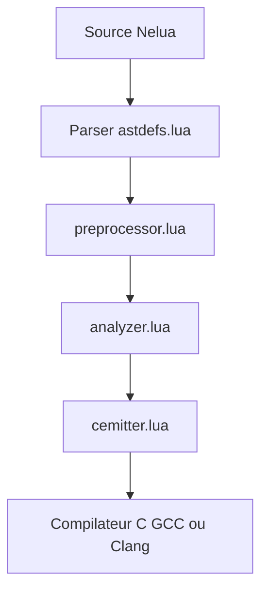

# edubart/nelua-lang

> Langage de programmation système proche de Lua, qui compile vers C, pour performances et métaprogrammation.

## Le problème
Lua est trop lent pour un système ou un jeu, et C est lourd à écrire : l'auteur veut les deux dans une seule syntaxe.

## Ce que ça fait vraiment
Le compilateur, écrit en Lua, analyse le code, déroule le préprocesseur Lua, vérifie les types, génère du C lisible, puis appelle un compilateur C pour produire le binaire. Le ramasse-miettes est optionnel ; la mémoire peut être manuelle. Le README précise que le langage est en alpha.

## Comment c'est branché


## Essayer
```bash
nelua examples/snakesdl.nelua
```

## Coût et pièges
Gratuit. Il faut un compilateur C (GCC ou Clang) ; l'installation n'est pas détaillée dans ce README. Dernier push en juin 2025, un seul mainteneur, alpha.

## Ce que ce n'est pas
Pas un Lua accéléré : une langue distincte, typée, qui produit du C.

## Alternatives
Aucune alternative nommée dans le README.

## Pour toi
À ignorer : langage de niche en alpha sans écosystème numérique ni IA.

