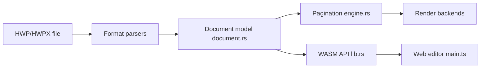

# edwardkim/rhwp

> Rust/WebAssembly reader and editor for Korean HWP/HWPX files, with a CLI and an MCP server.

## The problem
Hancom's HWP format is closed: reading or filling these documents outside the official software is difficult.

## What it actually does
Parsing of HWP 5.0, HWPX and HML, layout (columns, tables, formulas), SVG, PNG and PDF export, web editor with an hwpctl-compatible API. npm packages `@rhwp/core` and `@rhwp/editor`, browser and VS Code extensions. An MCP server (`rhwp mcp-serve`) exposes `hwp_info`, `hwp_search`, `hwp_fill_fields` to agents. Claims more than 3,400 Rust tests.

## How it is wired


## Trying it
```bash
./rhwp/rhwp capabilities
rhwp export-svg sample.hwp -o my_dir/
rhwp export-pdf sample.hwp -o out.pdf
npm install @rhwp/core
```

## Cost and gotchas
Free. WASM build via Docker. The "Hangul" and "HWP" trademarks belong to Hancom, with no affiliation. The README is mostly in Korean. HML support is limited.

## What it is not
Not a faithful copy of Hancom: version 0.8.x, rendering and formats partially covered, 370 open issues.

## Alternatives
No alternative named in the README.

## For you
Watch: useful if your data includes Korean administrative documents to convert for a pipeline, otherwise irrelevant.
