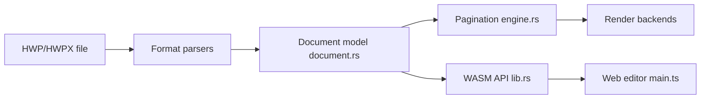

# edwardkim/rhwp

> Lecteur et éditeur Rust/WebAssembly de fichiers HWP/HWPX coréens, avec CLI et serveur MCP.

## Le problème
Le format HWP de Hancom est fermé : lire ou remplir ces documents hors du logiciel officiel est difficile.

## Ce que ça fait vraiment
Analyse HWP 5.0, HWPX et HML, mise en page (colonnes, tableaux, formules), export SVG, PNG et PDF, éditeur web avec API compatible hwpctl. Paquets npm `@rhwp/core` et `@rhwp/editor`, extensions navigateur et VS Code. Un serveur MCP (`rhwp mcp-serve`) expose `hwp_info`, `hwp_search`, `hwp_fill_fields` aux agents. Revendique plus de 3 400 tests Rust.

## Comment c'est branché


## Essayer
```bash
./rhwp/rhwp capabilities
rhwp export-svg sample.hwp -o my_dir/
rhwp export-pdf sample.hwp -o out.pdf
npm install @rhwp/core
```

## Coût et pièges
Gratuit. Build WASM via Docker. Marques « Hangul » et « HWP » appartenant à Hancom, sans affiliation. Le README est surtout en coréen. La prise en charge de HML est limitée.

## Ce que ce n'est pas
Pas une copie fidèle de Hancom : version 0.8.x, rendu et formats partiellement couverts, 370 issues ouvertes.

## Alternatives
Aucune alternative nommée dans le README.

## Pour toi
À surveiller : utile si tes données incluent des documents administratifs coréens à convertir pour un pipeline, sinon sans objet.

