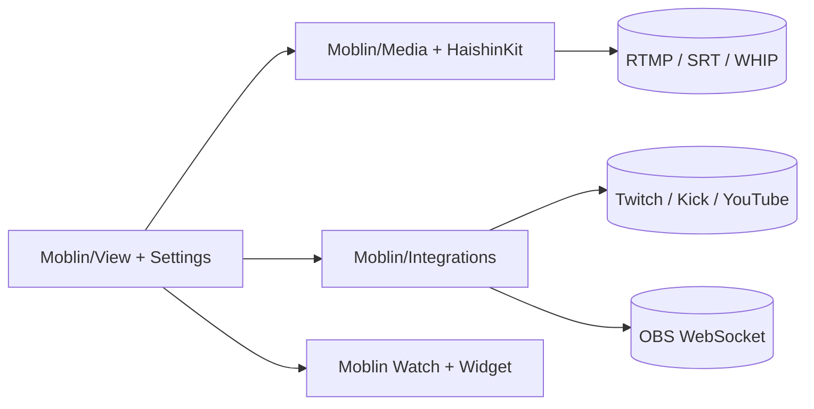

# eerimoq/moblin

> Free iOS app for outdoor streaming (RTMP, SRT, WHIP) to Twitch, YouTube, Kick and OBS.

## The problem
Streaming live from a phone with several connections, overlays and chat requires a mix of apps.

## What it actually does
Streams over RTMP(S), SRT(LA), RIST or WHIP with connection bonding (cellular, Wi-Fi, Ethernet), scenes and widgets (chat, alerts, map, weather, scores), video effects, local recording and OBS remote control. Integrations with Twitch, Kick, YouTube, DJI devices, an Apple Watch app, settings import via `moblin://` and a JavaScript API for browser widgets.

## How it is wired


## Trying it
```bash
git clone https://github.com/eerimoq/moblin.git
cd moblin
cp User.template.xcconfig Config/User.xcconfig
open Moblin.xcodeproj
```

## Cost and gotchas
Free; building requires Xcode and an iPhone in developer mode; TestFlight is available. 120 FPS "at your own risk". The README warns that video cannot be captured in the background.

## What it is not
Not studio software: it is a mobile app. The README's feature list is very long, with no maturity indication per item.

## Alternatives
- irlpro.app: outdoor streaming app.
- Larix (softvelum.com): iOS broadcasting application.
- Twitch app.

## For you
Ignore: video streaming tool, unrelated to data/AI/MLOps.
