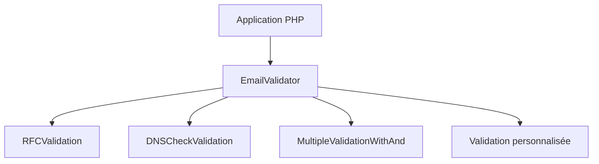

# egulias/EmailValidator

> A PHP library for validating email addresses against several RFCs, aimed at PHP developers.

## The problem
Home-made regular expressions validate email addresses poorly and do not follow the RFCs.

## What it actually does
You choose a validation strategy per call: RFC, RFC without warnings, DNS check, combination by logical AND, message ID, or spoofing protection through UTF-8 characters. You can write your own validation by implementing `EmailValidation`. The DNS check does not guarantee that the mailbox exists.

## How it is wired
Simplified diagram based on the sheet, no diagram provided.


## Trying it
```bash
composer require egulias/email-validator
```

## Cost and gotchas
Free. PHP 8.1 and Composer are required (PHP is not in the prerequisites list); the Intl extension is required for the spoofing check and DNS.

## What it is not
Not proof that an address exists or that it receives mail.

## Alternatives
No alternative named in the README.

## For you
Ignore: it is a PHP building block; in Python, an email validator from your stack is enough.
