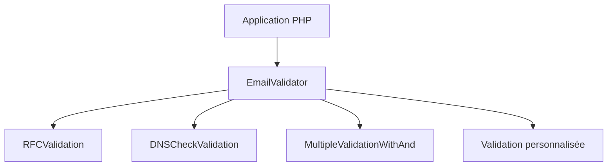

# egulias/EmailValidator

> Bibliothèque PHP pour valider des adresses e-mail selon plusieurs RFC, destinée aux développeurs PHP.

## Le problème
Les expressions régulières maison valident mal les adresses e-mail et ne suivent pas les RFC.

## Ce que ça fait vraiment
On choisit une stratégie de validation par appel : RFC, RFC sans avertissements, vérification DNS, combinaison par ET logique, identifiant de message ou anti-usurpation par caractères UTF-8. On peut écrire sa propre validation en implémentant `EmailValidation`. La vérification DNS ne garantit pas que la boîte existe.

## Comment c'est branché
Schéma simplifié d'après la fiche, sans diagramme fourni.


## Essayer
```bash
composer require egulias/email-validator
```

## Coût et pièges
Gratuit. PHP 8.1 et Composer sont nécessaires (PHP n'est pas dans la liste de prérequis) ; l'extension Intl est requise pour le contrôle anti-usurpation et DNS.

## Ce que ce n'est pas
Pas une preuve qu'une adresse existe ni qu'elle reçoit du courrier.

## Alternatives
Aucune alternative nommée dans le README.

## Pour toi
À ignorer : c'est une brique PHP ; en Python, un validateur d'e-mails de ta pile suffit.

