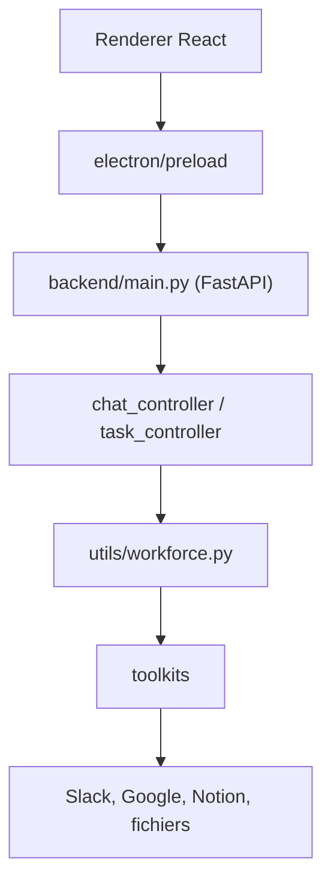

# eigent-ai/eigent

> Open source desktop application that orchestrates a team of AI agents to automate tasks.

## The problem
Chaining complex tasks (research, files, third-party tools) with a single agent is slow. You need a way to distribute them in parallel.

## What it actually does
Electron application with an embedded FastAPI backend, built on CAMEL-AI. A single agent or a multi-agent workforce uses toolkits (browser, terminal, files, Slack, Google, Notion). It accepts local models (vLLM, Ollama, LM Studio) and MCP. The quick start connects to Eigent's cloud.

## How it is wired


## Trying it
```bash
git clone https://github.com/eigent-ai/eigent.git
cd eigent
npm install
npm run dev
```

## Cost and gotchas
Node 18 to 22. This mode connects to Eigent's cloud and requires an account. The full local deployment is recommended. Third-party models may be billed.

## What it is not
Not an agent framework: it is a desktop application. The Enterprise and Cloud versions are separate offerings.

## Alternatives
No alternative named in the README; it builds on CAMEL-AI.

## For you
Worth watching: useful for testing multi-agent workflows locally, to be verified in local mode without the cloud.
