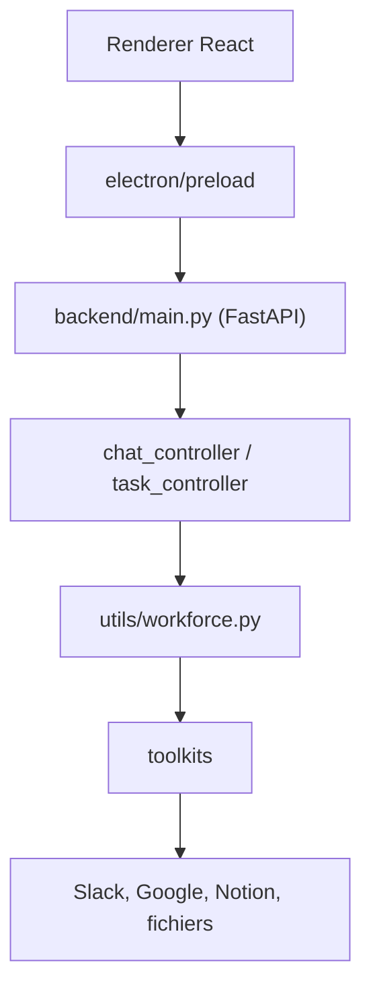

# eigent-ai/eigent

> Application de bureau open source qui orchestre une équipe d'agents IA pour automatiser des tâches.

## Le problème
Enchaîner des tâches complexes (recherche, fichiers, outils tiers) avec un seul agent est lent. Il faut un moyen de les répartir en parallèle.

## Ce que ça fait vraiment
Application Electron avec un backend FastAPI embarqué, bâti sur CAMEL-AI. Un agent unique ou une workforce multi-agents utilise des toolkits (navigateur, terminal, fichiers, Slack, Google, Notion). Elle accepte des modèles locaux (vLLM, Ollama, LM Studio) et MCP. Le démarrage rapide se connecte au cloud d'Eigent.

## Comment c'est branché


## Essayer
```bash
git clone https://github.com/eigent-ai/eigent.git
cd eigent
npm install
npm run dev
```

## Coût et pièges
Node 18 à 22. Ce mode se connecte au cloud d'Eigent et exige un compte. Le déploiement local complet est recommandé. Des modèles tiers peuvent être facturés.

## Ce que ce n'est pas
Pas un framework d'agents : c'est une application de bureau. Les versions Enterprise et Cloud sont des offres séparées.

## Alternatives
Aucune alternative nommée dans le README ; il s'appuie sur CAMEL-AI.

## Pour toi
À surveiller : utile pour tester des workflows multi-agents en local, à vérifier en mode local sans cloud.

