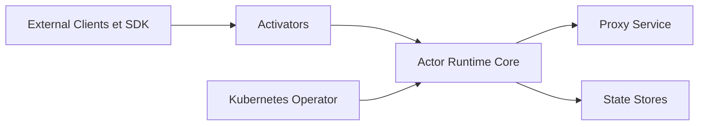

# eigr/spawn

> Durable-state actor runtime in Elixir, callable via Erlang, gRPC or HTTP, for multi-language teams.

## The problem
Managing state in a distributed system requires writing a lot of infrastructure glue: persistence, protocols, crash recovery.

## What it actually does
You describe an actor once in Protobuf, with its state options (snapshot, deactivation delay). The Elixir runtime exposes it as a native Erlang call, gRPC and HTTP with transcoding. Activators (Kafka, RabbitMQ, SQS, PubSub) feed the actors, a Kubernetes operator handles deployment, and state goes into Postgres or MariaDB.

## How it is wired


## Trying it
```bash
grpcurl -d '{"value":10}' \
  -plaintext localhost:9000 \
  example.actors.ExampleActor/Sum

curl -X POST http://localhost:9000/v1/example/sum \
  -H "Content-Type: application/json" \
  -d '{"value": 10}'
```

## Cost and gotchas
An example actor must already be running on localhost:9000: the README does not show how to start it. The target deployment is Kubernetes, with a Postgres or MariaDB state store.

## What it is not
Not a data or AI framework: it is application infrastructure in Elixir. No installation guide in the README, only pointers to the documentation.

## Alternatives
Cloudstate: the README says the authors are contributors to it, but does not present it as an alternative.

## For you
Worth watching: the idea of multi-protocol stateful actors could be used to orchestrate agents, but the Elixir and Kubernetes stack is heavy and outside your usual profile.
