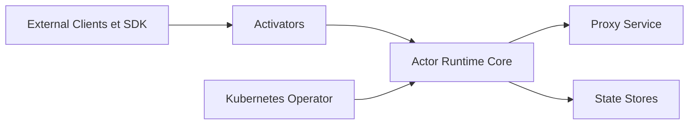

# eigr/spawn

> Runtime d'acteurs à état durable en Elixir, appelable en Erlang, gRPC ou HTTP, pour équipes multi-langages.

## Le problème
Gérer l'état dans un système distribué oblige à écrire beaucoup de colle d'infrastructure : persistance, protocoles, reprise après panne.

## Ce que ça fait vraiment
On décrit un acteur une fois en Protobuf, avec ses options d'état (snapshot, délai de désactivation). Le runtime Elixir l'expose en appel Erlang natif, gRPC et HTTP avec transcodage. Des activateurs (Kafka, RabbitMQ, SQS, PubSub) alimentent les acteurs, un opérateur Kubernetes gère le déploiement, et l'état va dans Postgres ou MariaDB.

## Comment c'est branché


## Essayer
```bash
grpcurl -d '{"value":10}' \
  -plaintext localhost:9000 \
  example.actors.ExampleActor/Sum

curl -X POST http://localhost:9000/v1/example/sum \
  -H "Content-Type: application/json" \
  -d '{"value": 10}'
```

## Coût et pièges
Un acteur d'exemple doit déjà tourner sur localhost:9000 : le README ne montre pas comment le lancer. Le déploiement visé est Kubernetes, avec un magasin d'état Postgres ou MariaDB.

## Ce que ce n'est pas
Pas un framework data ou IA : c'est de l'infrastructure applicative en Elixir. Pas de guide d'installation dans le README, seulement des renvois vers la documentation.

## Alternatives
Cloudstate : le README dit que les auteurs en sont contributeurs, mais ne le présente pas comme une alternative.

## Pour toi
À surveiller : l'idée d'acteurs à état multi-protocoles peut servir à orchestrer des agents, mais la pile Elixir et Kubernetes est lourde et hors de ton profil habituel.

